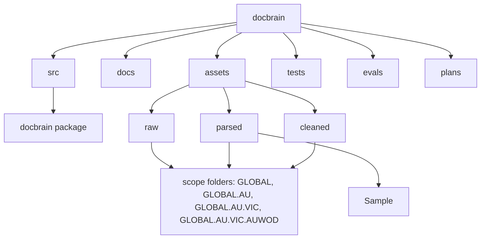

# Docbrain Project Structure

See the [implementation plan](../plans/implementation_plan.md) for delivery phases and contracts, and the [coding backlog](../plans/coding_tasks.md) for source-driven tasks and acceptance cases. The current repository contains reference code, parsed legislation, and a raw Recycling Act example; the target layout below is a plan, not a list of implemented components.

## Current layout



- `/src/docbrain` Installable package (`pyproject.toml`, `uv.lock`): prototype modules plus offline domain models, Markdown parsing, references, registry, and workflow logic. See the implementation status in the [coding backlog](../plans/coding_tasks.md#implementation-status).
- `/tests` Offline unit tests and reviewed fixtures. Run `uv sync`, then `uv run pytest`, `uv run ruff check src tests`, and `uv run mypy`.
- `/evals` Structured evaluation cases (Recycling Act E01–E20).
- `/assets/raw/<scope>` PDF, DOCX, HTML original documents stored in folders with json metadata sidecar.
- `/assets/parsed/<scope>` Text, Markdown, JSON documents after parsing original documents.
- `/assets/parsed/Sample` The two candidate renderings of the Recycling Act used for parser comparison.
- `/assets/cleaned/<scope>` Manually cleaned documents after parsing.
- `/docs` Markdown documentation for humans and agents.
- `/plans` Implementation plan, coding backlog, and the future process application ([process_pipeline_future](../plans/process_pipeline_future/README.md)).
- `/src` Scripts, Source Code

`<scope>` is a dotted scope code: `GLOBAL`, `GLOBAL.AU`, `GLOBAL.AU.VIC`, or `GLOBAL.AU.VIC.AUWOD` (Wodonga). A location scope inherits every ancestor scope by dotted segment. Scope is a necessary filter, not proof of applicability; applicability conditions are defined by the regulatory pipeline.

`assets/parsed/GLOBAL.AU` contains seven Markdown files, one per Act. `assets/parsed/Sample` holds the two candidate renderings of the Recycling Act compilation `C2026C00317`: `C2020A00119_LawCodex.md`, the earlier structured Markdown (the same bytes as `assets/parsed/GLOBAL.AU/C2020A00119-recycling-and-waste-reduction-act-2020.md`), and `C2020A00119_Liteparse.md`, the supplied LiteParse export (formerly `assets/parsed/GLOBAL.AU/C2026C00317.md`). Keep them as separate derivations, not separate legal versions or duplicate corroborating evidence. `assets/raw/GLOBAL.AU/Recycling and Waste Reduction Act 2020` contains `C2026C00317.pdf` and its JSON metadata sidecar for the first source-driven implementation example. The [coding backlog](../plans/coding_tasks.md) records comparison findings and parser-quality gates. The human approval step between parsed and cleaned is paused: outputs from multiple parsers will be compared, and if one is good enough, the manual correction step is removed. `cleaned` remains a lifecycle folder, not evidence that approved corrections are available. Preserve source bytes; cleaned documents become versioned derived artifacts with provenance.

## Target application layout

Create modules when their delivery phase needs them, rather than scaffolding empty directories. Establish the current modules' behavior first; DB-001 moves reusable code into the installable `docbrain` package in a behavior-preserving step with import tests before later tasks add new behavior. Preserve module names and supported imports deliberately.

```text
pyproject.toml                  # dependencies, CLI entry point, quality tools
uv.lock                         # tested dependency resolution
.env.example                    # variable names only; no credentials
src/docbrain/
├── models.py                   # canonical source, version, evidence contracts
├── settings.py                 # validated endpoint/capability settings
├── api.py                      # FastAPI transport and trusted request context
├── cli.py                      # operator and local query commands
├── worker.py                   # job leases, recovery, concurrency, cancellation
├── registry.py                 # versions, manifests, jobs, approvals, audit
├── parsing.py                  # canonical AST normalization and source spans
├── chunking.py                 # structural boundaries and dual text
├── router.py                   # intent and bounded dispatch plans
├── broker_fusion.py            # evidence grounding, fusion, reranking, budgets
├── semantic_tree.py            # document/corpus summaries and dependencies
├── graph_engine.py             # typed extraction, resolution, graph semantics
├── lifecycle.py                # publication, invalidation, retention, reconciliation
├── adapters/
│   ├── models.py               # LiteLLM integration and role aliases
│   ├── parser.py               # selected Docling/LiteParse service adapter
│   ├── vector.py               # Qdrant SDK, dense/sparse search, point IDs
│   ├── graph.py                # Memgraph queries and capability checks
│   └── artifacts.py            # source and derived artifact persistence
├── workflows/
│   ├── ingestion.py            # resumable LangGraph ingestion
│   ├── answering.py            # bounded corrective retrieval and verification
│   └── change_review.py        # version comparison, impact, shared human approval
└── prompts/                    # versioned extraction/synthesis/review prompts
migrations/                     # explicit Postgres, Qdrant, Memgraph schema changes
tests/
├── unit/                       # domain behavior, no hosted dependencies
├── contracts/                  # adapter behavior against disposable services
├── integration/                # public API and recovery scenarios
└── fixtures/                   # small, redistributable source/expected-span fixtures
evals/                          # reviewed questions, runner, retrieval ablations
docs/                           # architecture, stage guidance, operations
plans/                          # implementation plan, coding backlog, future process application
assets/                         # curated corpus, not production state/checkpoints
```

`documentation.py` and `workflows/documentation.py` are no longer DocBrain modules; they moved to `plans/process_pipeline_future/code/src/docbrain/`. Process documentation (Compliance Agent, Documentation Agent, site-specific policies and procedures) is a separate future application; see [process_pipeline_future](../plans/process_pipeline_future/README.md).

## Existing code migration map

| Existing module | Preserve or extend | Required change before production use |
| --- | --- | --- |
| `src/docbrain/models.py` | Typed evidence and provenance concepts | Version/build/scope identity, source spans, dual text, validated schemas. |
| `src/docbrain/router.py` | Intent labels and dispatch concept | Import fixes, mixed-intent behavior, capability-aware bounded fallback. |
| `src/docbrain/broker_fusion.py` | Weighted RRF and evidence packaging | Real retrieval/grounding, adapter-normalized candidates, explicit score semantics and token accounting. |
| `src/docbrain/semantic_tree.py` | Summary construction and search concept | Parent links, empty/single-chunk cases, corpus roots, persistence and invalidation. |
| `src/docbrain/graph_engine.py` | Extraction and provenance concepts | Regulatory ontology, safe resolution, Memgraph adapter, idempotent writes and actual scoped community jobs. |
| `src/docbrain/lifecycle.py` | Hash comparison and cleanup intent | Full pagination, immutable builds, manifest publication, retained history and retryable cleanup. |

Application code owns domain behavior and LangGraph workflows. Adapters own external protocols and SDK objects. Registry transactions own publication/approval decisions. Hosted service administration remains outside this repository's runtime responsibilities.
