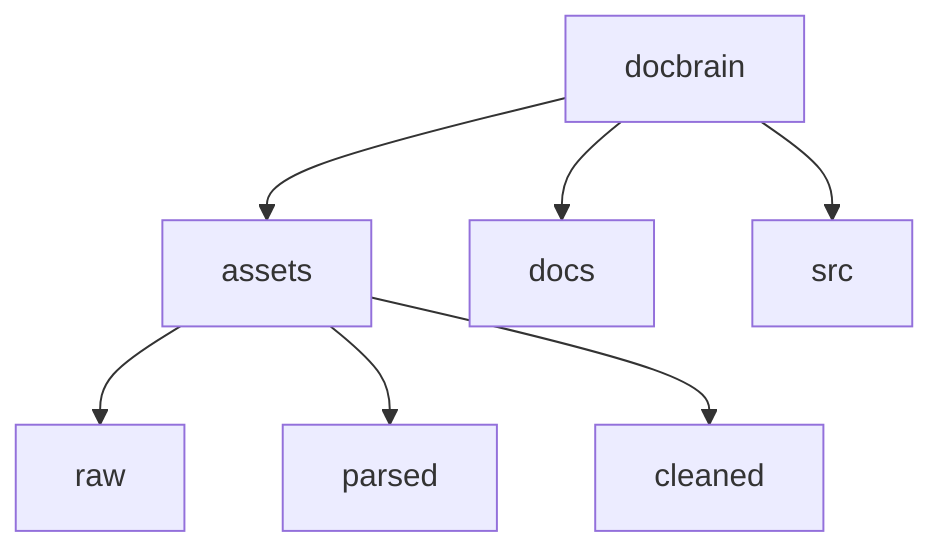

# Docbrain Project Structure

See the [implementation plan](./implementation_plan.md) for delivery phases and contracts. The current repository contains reference code and parsed legislation; the target layout below is a plan, not a list of implemented components.

## Current layout



- `/assets/raw` PDF, DOCX, HTML original documents stored in folders with json metadata sidecar.
- `/assets/parsed` Text, Markdown, JSON documents after parsing original documents.
- `/assets/cleaned` Manually cleaned documents after parsing.
- `/docs` Markdown documentation for humans and agents.
- `/src` Scripts, Source Code

Only `assets/parsed/GLOBAL.AU` is currently populated. `raw` and `cleaned` are lifecycle conventions, not evidence that original files or approved corrections are available. Preserve source bytes; cleaned documents become versioned derived artifacts with provenance.

## Target application layout

Create modules when their delivery phase needs them, rather than scaffolding empty directories. Keep current modules in place during Phase 0; move reusable code into the installable `docbrain` package in a behavior-preserving step with import tests before adding new behavior.

```text
pyproject.toml                  # dependencies, CLI entry point, quality tools
uv.lock                         # tested dependency resolution
.env.example                    # variable names only; no credentials
src/docbrain/
├── models.py                   # canonical source, version, evidence contracts
├── settings.py                 # validated endpoint/capability settings
├── api.py                      # FastAPI transport and trusted request context
├── cli.py                      # operator and local query commands
├── worker.py                   # job leases, recovery, concurrency, cancellation
├── registry.py                 # versions, manifests, jobs, approvals, audit
├── parsing.py                  # canonical AST normalization and source spans
├── chunking.py                 # structural boundaries and dual text
├── router.py                   # intent and bounded dispatch plans
├── broker_fusion.py            # evidence grounding, fusion, reranking, budgets
├── semantic_tree.py            # document/corpus summaries and dependencies
├── graph_engine.py             # typed extraction, resolution, graph semantics
├── lifecycle.py                # publication, invalidation, retention, reconciliation
├── adapters/
│   ├── models.py               # LiteLLM integration and role aliases
│   ├── parser.py               # selected Docling/LiteParse service adapter
│   ├── vector.py               # Qdrant SDK, dense/sparse search, point IDs
│   ├── graph.py                # Memgraph queries and capability checks
│   └── artifacts.py            # source and derived artifact persistence
├── workflows/
│   ├── ingestion.py            # resumable LangGraph ingestion
│   ├── answering.py            # bounded corrective retrieval and verification
│   └── change_review.py        # version comparison, impact, human approval
└── prompts/                    # versioned extraction/synthesis/review prompts
migrations/                     # explicit Postgres, Qdrant, Memgraph schema changes
tests/
├── unit/                       # domain behavior, no hosted dependencies
├── contracts/                  # adapter behavior against disposable services
├── integration/                # public API and recovery scenarios
└── fixtures/                   # small, redistributable source/expected-span fixtures
evals/                          # reviewed questions, runner, retrieval ablations
docs/                           # architecture, stage guidance, plan, operations
assets/                         # curated corpus, not production state/checkpoints
```

## Existing code migration map

| Existing module | Preserve or extend | Required change before production use |
| --- | --- | --- |
| `src/models.py` | Typed evidence and provenance concepts | Version/build/scope identity, source spans, dual text, validated schemas. |
| `src/router.py` | Intent labels and dispatch concept | Import fixes, mixed-intent behavior, capability-aware bounded fallback. |
| `src/broker_fusion.py` | Weighted RRF and evidence packaging | Real retrieval/grounding, adapter-normalized candidates, explicit score semantics and token accounting. |
| `src/semantic_tree.py` | Summary construction and search concept | Parent links, empty/single-chunk cases, corpus roots, persistence and invalidation. |
| `src/graph_engine.py` | Extraction and provenance concepts | Regulatory ontology, safe resolution, Memgraph adapter, idempotent writes and actual scoped community jobs. |
| `src/lifecycle.py` | Hash comparison and cleanup intent | Full pagination, immutable builds, manifest publication, retained history and retryable cleanup. |

Application code owns domain behavior and LangGraph workflows. Adapters own external protocols and SDK objects. Registry transactions own publication/approval decisions. Hosted service administration remains outside this repository's runtime responsibilities.
