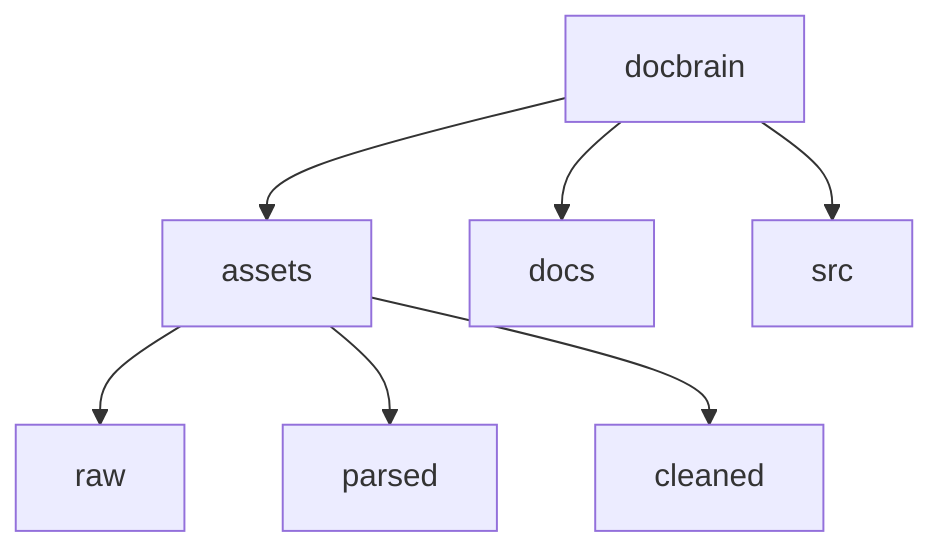

# Docbrain Project Structure

- `/assets/raw` PDF, DOCX, HTML original documents stored in folders with json metadata sidecar.
- `/assets/parsed` Text, Markdown, JSON documents after parsing original documents.
- `/assets/cleaned` Manually cleaned documents after parsing.
- `/docs` Markdown documentation for humans and agents.
- `/src` Scripts, Source Code