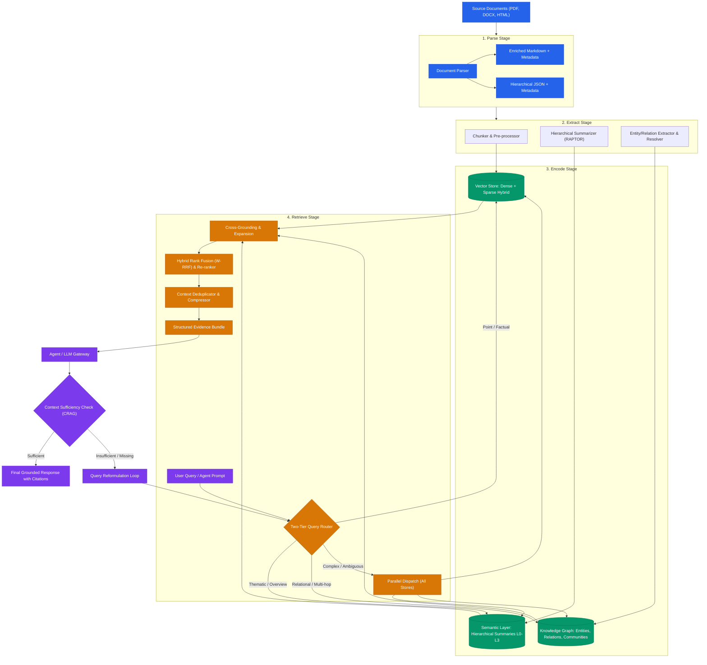
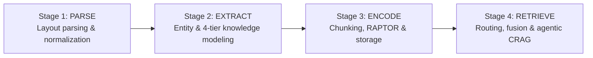
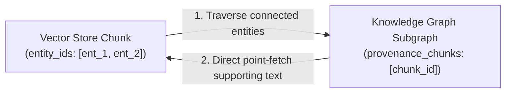
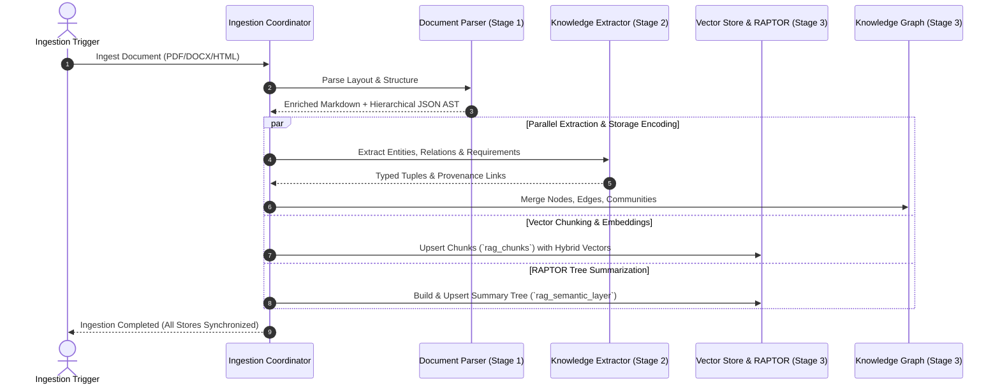
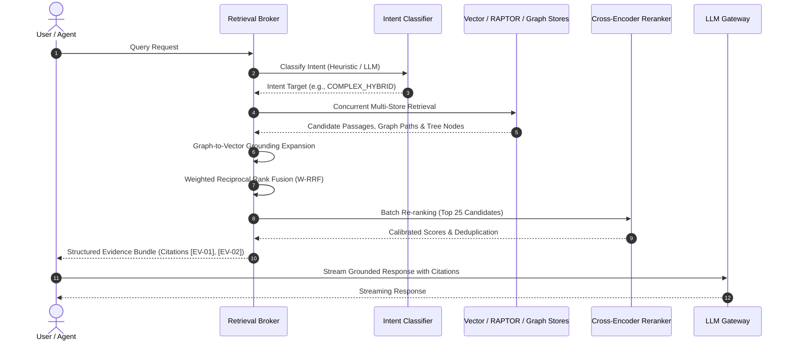
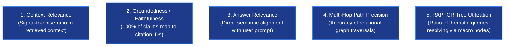

# Hybrid RAG Architecture

A unified, tri-focal retrieval architecture designed for high-precision regulatory compliance, risk analysis, and operational workflow generation.

---

## 1. System Vision & The Core Idea

Standard Retrieval-Augmented Generation (RAG) relies on uniform semantic vector search over isolated text chunks. While vector search excels at point-lookup queries, it fails in enterprise regulatory and governance contexts due to:
1. **Holistic / Thematic Blindness:** Inability to synthesize corpus-wide themes (*"What are the recurring compliance risks across all subsidiaries?"*).
2. **Multi-Hop Relational Disconnect:** Inability to traverse non-contiguous entity relationships across disparate documents (*"How does Supplier X connect to Facility Y through Outage Z?"*).
3. **Contextual & Structural Fragmentation:** Loss of document hierarchy, clause numbering, and tabular geometries during naive chunking.

The DocBrain architecture resolves these failure modes by constructing **three synchronized representations**:
- **Vector Store (Point Facts):** Fine-grained semantic chunk retrieval via dense/sparse hybrid embeddings.
- **Semantic Layer (Meso/Macro Summaries):** RAPTOR-style hierarchical tree of summaries for progressive drill-down.
- **Knowledge Graph (Structural / Topological Relationships):** GraphRAG-style entity-relation graph with community clustering and graph algorithms.

A central **Retrieval Broker** classifies query intent, routes to the appropriate representations, fuses candidate evidence via Weighted Reciprocal Rank Fusion (W-RRF), and generates a verified **Evidence Bundle** for downstream Agent synthesis.



---

## 2. Documentation Architecture & Lifecycle Stages

Detailed technical specifications, agent guidelines, schemas, and operational workflows are modularized into four dedicated lifecycle documents:



| Lifecycle Stage | Detailed Documentation Guide | Key Responsibilities | Reference Implementation |
| :--- | :--- | :--- | :--- |
| **Stage 1: Parse** | [rag_parse.md](./rag_parse.md) | Document structure parsing, dual Markdown/JSON AST, list/table unrolling, pronoun de-anonymization, sentence atomization, and RFC 2119 modality tagging. | [`models.py`](../src/models.py) |
| **Stage 2: Extract** | [rag_extract.md](./rag_extract.md) | 4-tier knowledge architecture (Document $\to$ Concept $\to$ Risk/Control $\to$ Workflow), schema-guided entity extraction, Leiden community detection, and audit-safe graph evolution. | [`graph_engine.py`](../src/graph_engine.py) |
| **Stage 3: Encode** | [rag_encode.md](./rag_encode.md) | Layout-aware semantic chunking, dual-text indexing (normalized embeddings vs. verbatim payloads), recursive RAPTOR tree construction, storage collection DDLs, and differential ingestion. | [`semantic_tree.py`](../src/semantic_tree.py), [`lifecycle.py`](../src/lifecycle.py) |
| **Stage 4: Retrieve** | [rag_retrieve.md](./rag_retrieve.md) | Two-tier adaptive routing, multi-store search execution, Graph-to-Vector Grounding Expansion, Weighted RRF, cross-encoder re-ranking, and Corrective RAG (CRAG). | [`router.py`](../src/router.py), [`broker_fusion.py`](../src/broker_fusion.py) |

---

## 3. Canonical Data Model & Unified Grounding

To unify the three stores and eliminate isolated data silos, every entity, summary node, and text chunk references a deterministic canonical identifier schema implemented in [`models.py`](../src/models.py):

```
Canonical Identifier Schema:
  Document:    doc_id    = "doc_{sha256(source_uri)[:16]}"
  Chunk:       chunk_id  = "{doc_id}#c{chunk_index:04d}"
  Tree Node:   node_id   = "{doc_id}#L{level}_c{cluster_id:02d}"
  KG Entity:   entity_id = "ent_{slug(normalized_name)}"
  KG Relation: rel_id    = "rel_{source_id}_{type}_{target_id}"
```

### 3.1 Provenance Linkage Across Stores
- **Vector Store (Chunks):** Payload stores `{doc_id, chunk_id, section_path, page_numbers, entity_ids, content_hash}`.
- **Semantic Layer (Tree Nodes):** Payload stores `{node_id, doc_id, level, parent_id, children_ids, leaf_chunk_ids}`.
- **Knowledge Graph (Nodes & Edges):** Properties store `{provenance_chunks: [chunk_id], doc_ids: [doc_id], confidence: float}`.

### 3.2 Bidirectional Resolution Flow


1. **Vector $\to$ Graph:** Chunks store extracted `entity_ids`. When a chunk is retrieved, downstream agents can immediately inspect its local subgraph without running a separate graph search.
2. **Graph $\to$ Vector (Grounding Expansion):** When a graph traversal identifies relevant paths or community summaries, the broker reads `provenance_chunks` and fetches the underlying text chunks directly by primary key, bypassing redundant vector index lookups.

---

## 4. End-to-End Architectural Workflows

### 4.1 Ingestion & Synchronization Flow
Ingestion coordinates document parsing, parallel multi-store extraction, and differential updates across the storage layers:


*Detailed breakdown in [rag_parse.md](./rag_parse.md), [rag_extract.md](./rag_extract.md), and [rag_encode.md](./rag_encode.md).*

---

### 4.2 Query Routing & Retrieval Flow
The retrieval pipeline dispatches queries based on intent, fuses multi-store results, and synthesizes answers with inline citations:


*Detailed breakdown in [rag_retrieve.md](./rag_retrieve.md).*

---

## 5. Quality Assurance & Continuous Evaluation

To quantitatively validate retrieval performance and prevent compliance hallucination, continuous evaluation measures five core metrics:



- **Context Relevance:** Ratio of retrieved chunks directly contributing to the answer versus irrelevant noise.
- **Groundedness / Faithfulness:** Strict verification that 100% of claims in the generated response map to valid `citation_id` entries in the Evidence Bundle.
- **Answer Relevance:** Semantic alignment between the generated response and the user's original query.
- **Multi-Hop Traversal Accuracy:** Precision of relational paths traversed in the Knowledge Graph against gold standard compliance benchmarks.
- **Hierarchical Tree Utilization:** Frequency with which macro thematic queries resolve via high-level summary nodes rather than brute-force chunk scanning.