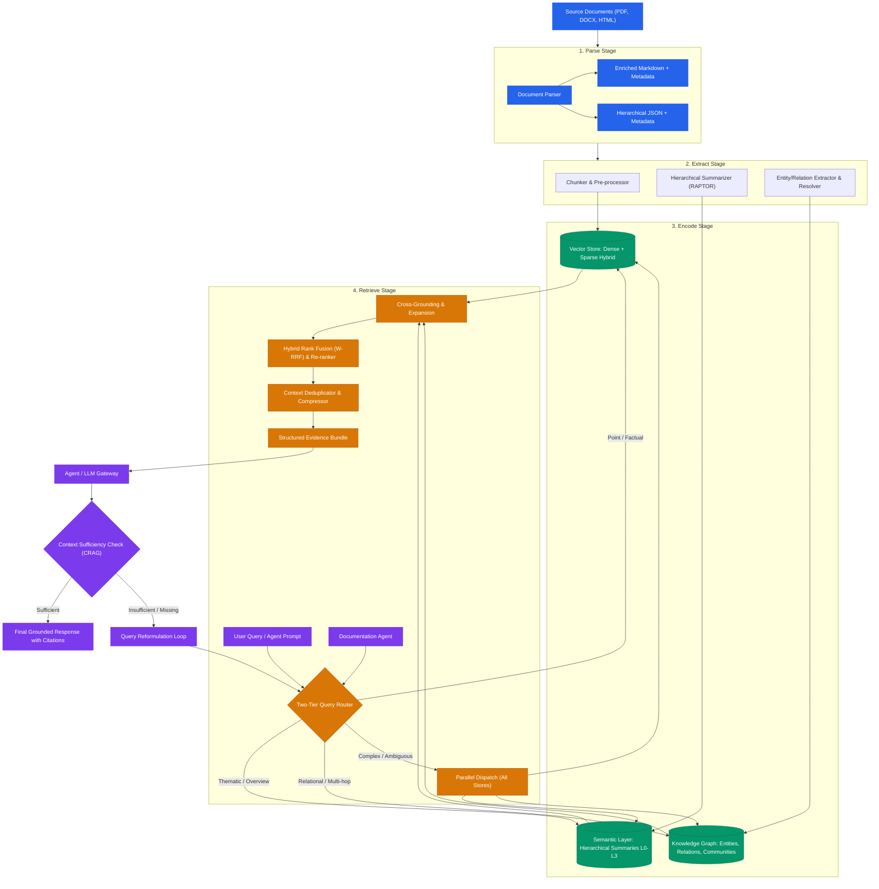
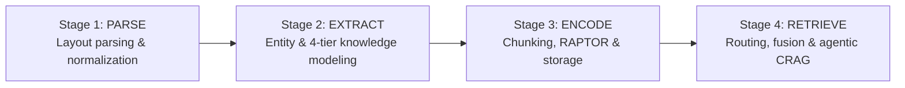
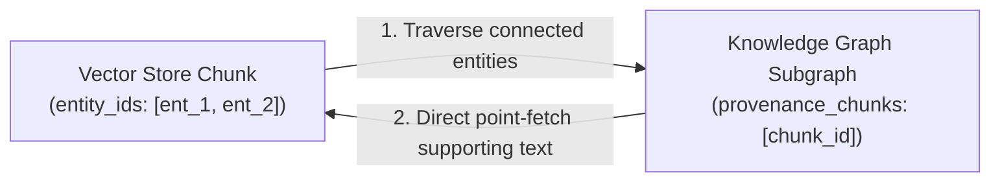
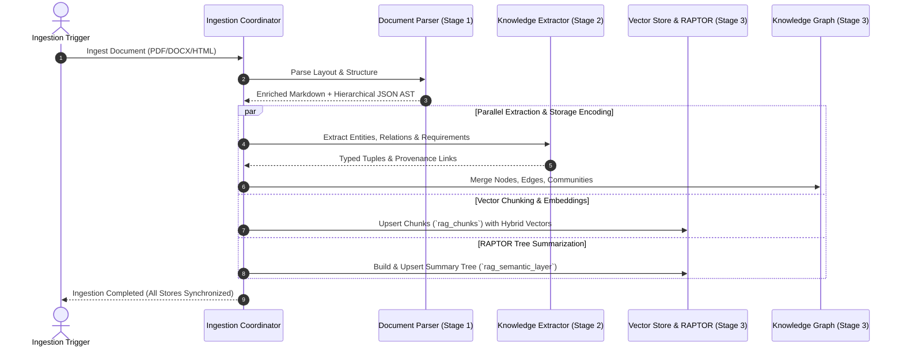
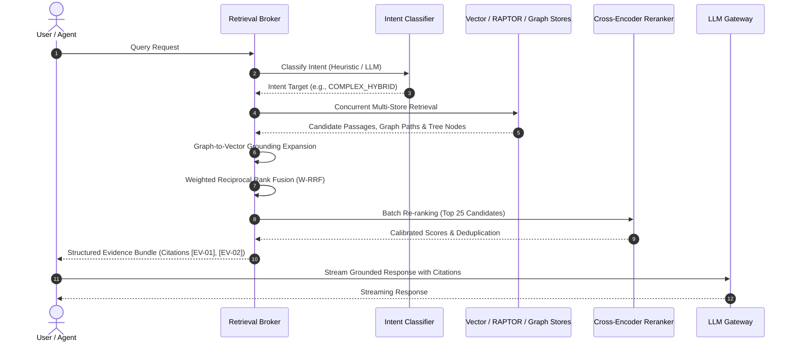
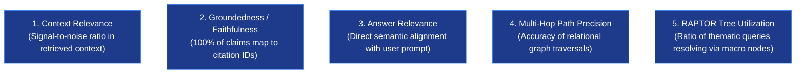

# Hybrid RAG Architecture

A unified, tri-focal retrieval architecture for regulatory compliance, risk analysis, and generation of site-specific policies, manuals, and procedures from regulatory, process, and site knowledge.

## Implementation baseline

**Start with the [implementation plan](./implementation_plan.md).** It defines phased delivery, authoritative contracts, acceptance gates, and open deployment assumptions. The diagrams below describe the full target; the current Python modules implement only parts of it.

- **Hosted dependencies:** LiteLLM, Docling or LiteParse, Qdrant, and Memgraph. Integrations are replaceable at tested adapter boundaries; switching storage still requires data migration.
- **In-repository execution:** LangChain tools/model composition and LangGraph ingestion, answering, and approval workflows. The retrieval broker and compliance agents are part of DocBrain, not separate products to procure.
- **Application state:** proposed PostgreSQL registry for immutable versions, publication manifests, jobs, audit records, and durable workflow checkpoints; original/derived files live in artifact storage.
- **Release order:** cited vector Q&A → grounded graph relationships → evaluated hierarchical/global retrieval and approval-gated site documentation. Mixed-source/site contracts start during ingestion; Documentation Agent delivery does not require optional community retrieval to succeed.
- **Consistency:** publish validated builds through an atomic registry manifest update. There is no distributed transaction across Qdrant and Memgraph; retries, reconciliation, and snapshot-scoped reads are required.
- **Trust:** tenant/site/process access checks apply to all stores, derived summaries, and exported documents. Extracted law, site facts, draft process descriptions, templates, proposed controls, and approved policy remain distinct. Citation presence alone does not prove claim support, applicability, or approval.
- **Documentation Agent:** lives in RETRIEVE and uses the shared broker to generate document packages; authenticated application operations handle review and publication to `assets/publish`. The model cannot approve itself, write arbitrary paths, or operate plant/business systems.

The [project structure](./project_structure.md) distinguishes existing files from planned modules. [Deployment guidance](./rag_deployment.md) separates the hosted-service target from legacy self-hosting examples.

### Knowledge inputs and generated outputs have different authority

The source-document input in the overview below includes legislation/rules, permits, standards/guidance, process descriptions, site/equipment facts, and existing organizational documents. All use PARSE → EXTRACT → ENCODE, retaining source class, revision, approval state, and authorized site/process scope. Templates are formatting inputs, not evidence for legal duties or operating limits. Topic similarity alone never establishes regulatory applicability.

The Documentation Agent's router arrow denotes a retrieval request; the Evidence Bundle also returns to that agent for drafting and verification. The ordinary Q&A response path is separate from controlled document publication. Knowledge-index publication does not approve a generated policy, and an existing file under `assets/publish` is not automatically approved knowledge.

---

## 1. System Vision & The Core Idea

Standard Retrieval-Augmented Generation (RAG) relies on uniform semantic vector search over isolated text chunks. While vector search excels at point-lookup queries, it fails in enterprise regulatory and governance contexts due to:
1. **Holistic / Thematic Blindness:** Inability to synthesize corpus-wide themes (*"What are the recurring compliance risks across all subsidiaries?"*).
2. **Multi-Hop Relational Disconnect:** Inability to traverse non-contiguous entity relationships across disparate documents (*"How does Supplier X connect to Facility Y through Outage Z?"*).
3. **Contextual & Structural Fragmentation:** Loss of document hierarchy, clause numbering, and tabular geometries during naive chunking.

The DocBrain architecture resolves these failure modes by constructing **three synchronized representations**:
- **Vector Store (Point Facts):** Fine-grained semantic chunk retrieval via dense/sparse hybrid embeddings.
- **Semantic Layer (Meso/Macro Summaries):** RAPTOR-style hierarchical tree of summaries for progressive drill-down.
- **Knowledge Graph (Structural / Topological Relationships):** GraphRAG-style entity-relation graph with community clustering and graph algorithms.

A central **Retrieval Broker** classifies query intent, routes to the appropriate representations, fuses candidate evidence via Weighted Reciprocal Rank Fusion (W-RRF), and generates a verified **Evidence Bundle** for downstream Agent synthesis.



---

## 2. Documentation Architecture & Lifecycle Stages

Detailed technical specifications, agent guidelines, schemas, and operational workflows are modularized into four dedicated lifecycle documents:



| Lifecycle Stage | Detailed Documentation Guide | Key Responsibilities | Reference Implementation |
| :--- | :--- | :--- | :--- |
| **Stage 1: Parse** | [rag_parse.md](./rag_parse.md) | Document structure parsing, dual Markdown/JSON AST, list/table unrolling, pronoun de-anonymization, sentence atomization, and RFC 2119 modality tagging. | [`models.py`](../src/models.py) |
| **Stage 2: Extract** | [rag_extract.md](./rag_extract.md) | 4-tier knowledge architecture (Document $\to$ Concept $\to$ Risk/Control $\to$ Workflow), schema-guided entity extraction, Leiden community detection, and audit-safe graph evolution. | [`graph_engine.py`](../src/graph_engine.py) |
| **Stage 3: Encode** | [rag_encode.md](./rag_encode.md) | Layout-aware semantic chunking, dual-text indexing (normalized embeddings vs. verbatim payloads), recursive RAPTOR tree construction, storage collection DDLs, and differential ingestion. | [`semantic_tree.py`](../src/semantic_tree.py), [`lifecycle.py`](../src/lifecycle.py) |
| **Stage 4: Retrieve** | [rag_retrieve.md](./rag_retrieve.md) | Routing, grounding, fusion, corrective Q&A, and Documentation Agent generation with applicability assessment, package validation, human review, and controlled export. | [`router.py`](../src/router.py), [`broker_fusion.py`](../src/broker_fusion.py); planned `workflows/documentation.py` |

---

## 3. Canonical Data Model & Unified Grounding

To unify the three stores, every entity, summary node, and text chunk needs deterministic identity and source provenance. [`models.py`](../src/models.py) contains the initial models. The following is the **legacy prototype naming scheme**, not the production identity contract:

```
Canonical Identifier Schema:
  Document:    doc_id    = "doc_{sha256(source_uri)[:16]}"
  Chunk:       chunk_id  = "{doc_id}#c{chunk_index:04d}"
  Tree Node:   node_id   = "{doc_id}#L{level}_c{cluster_id:02d}"
  KG Entity:   entity_id = "ent_{slug(normalized_name)}"
  KG Relation: rel_id    = "rel_{source_id}_{type}_{target_id}"
```

Implementation adds tenant-scoped document identity, immutable source versions, pipeline build IDs, and versioned assertions as specified in the [plan](./implementation_plan.md#4-contracts-that-must-precede-indexing). Source URLs and normalized entity names are aliases, not sufficient identities. Qdrant point IDs are deterministic UUIDs mapped from canonical IDs; readable strings remain in payloads. Cross-document summary roots belong to a corpus snapshot rather than one document.

### 3.1 Provenance Linkage Across Stores
- **Vector Store (Chunks):** Payload stores `{doc_id, chunk_id, section_path, page_numbers, entity_ids, content_hash}`.
- **Semantic Layer (Tree Nodes):** Payload stores `{node_id, doc_id, level, parent_id, children_ids, leaf_chunk_ids}`.
- **Knowledge Graph (Nodes & Edges):** Properties store `{provenance_chunks: [chunk_id], doc_ids: [doc_id], confidence: float}`.

### 3.2 Bidirectional Resolution Flow


1. **Vector $\to$ Graph:** Chunks store extracted `entity_ids`. When a chunk is retrieved, downstream agents can immediately inspect its local subgraph without running a separate graph search.
2. **Graph $\to$ Vector (Grounding Expansion):** When a graph traversal identifies relevant paths or community summaries, the broker reads `provenance_chunks` and fetches the underlying text chunks directly by primary key, bypassing redundant vector index lookups.

---

## 4. End-to-End Architectural Workflows

### 4.1 Ingestion & Synchronization Flow
Ingestion coordinates document parsing, parallel multi-store extraction, and differential updates across the storage layers:


*Detailed breakdown in [rag_parse.md](./rag_parse.md), [rag_extract.md](./rag_extract.md), and [rag_encode.md](./rag_encode.md).*

---

### 4.2 Query Routing & Retrieval Flow
The retrieval pipeline dispatches queries based on intent, fuses multi-store results, and synthesizes answers with inline citations:


*Detailed breakdown in [rag_retrieve.md](./rag_retrieve.md).*

---

### 4.3 Documentation Agent: evidence to controlled site documents

```diagram
┌───────────────────────────┐     ┌──────────────────────────────┐
│ Site/process + document   │────▶│ Documentation Agent          │
│ request + template refs   │     │ Authorize, pin, plan sections│
└───────────────────────────┘     └──────────────┬───────────────┘
                                               │ section queries
                                               ▼
┌───────────────────────────┐     ┌──────────────────────────────┐
│ Scoped knowledge: law,    │◀───▶│ Shared Retrieval Broker      │
│ permits, processes, sites │     │ Evidence + missing sources   │
└───────────────────────────┘     └──────────────┬───────────────┘
                                               ▼
                                 ┌──────────────────────────────┐
                                 │ Applicability + drafting     │
                                 │ Policy / manual / procedure  │
                                 └──────────────┬───────────────┘
                                               ▼
                                 ┌──────────────────────────────┐
                                 │ Verify coverage, consistency │
                                 │ and source support; list gaps│
                                 └──────────────┬───────────────┘
                                               ▼
                                 ┌──────────────────────────────┐
                                 │ Authorized human review      │
                                 │ Reject/revise or approve hash│
                                 └──────────────┬───────────────┘
                                               ▼
                                 ┌──────────────────────────────┐
                                 │ Controlled application export│
                                 │ assets/publish/.../revision/ │
                                 └──────────────────────────────┘
```

LangGraph checkpoints preserve the outline, per-section drafts, source snapshot, applicability decisions, missing facts, and review state. The agent links applicable requirements → controls → document sections/steps, retaining exact regulatory and operational source spans. Process or site changes are first-class change triggers alongside law changes. Conflicts and unresolved dependencies require review, not automatic precedence based on retrieval score.

Exports contain Markdown documents, a package manifest, evidence mappings, and review/gap records. Draft exports are marked **not for operational use**; only approved, dependency-current revisions can become the registry's published package. Safe staging and idempotent publication preserve previous complete packages. Approval is bound to exact content and dependencies; edits or source changes invalidate it. Generated documents are not recursively ingested as independent authority.

Existing P-001 and WI-007 are draft examples with unresolved operating values and missing source references. Preserve them unchanged; registration must record their actual trust status. Safety-critical gaps require qualified technical review before publication. The [implementation plan](./implementation_plan.md#documentation-agent-workflow-retrieve) defines package paths, contracts, API, and review rules; DB-031–DB-035 in the [backlog](./coding_tasks.md) define delivery checks.

---

## 5. Quality Assurance & Continuous Evaluation

To quantitatively validate retrieval performance and prevent compliance hallucination, continuous evaluation measures five core metrics:



- **Context Relevance:** Ratio of retrieved chunks directly contributing to the answer versus irrelevant noise.
- **Groundedness / Faithfulness:** Strict verification that 100% of claims in the generated response map to valid `citation_id` entries in the Evidence Bundle.
- **Answer Relevance:** Semantic alignment between the generated response and the user's original query.
- **Multi-Hop Traversal Accuracy:** Precision of relational paths traversed in the Knowledge Graph against gold standard compliance benchmarks.
- **Hierarchical Tree Utilization:** Frequency with which macro thematic queries resolve via high-level summary nodes rather than brute-force chunk scanning.
- **Documentation quality:** reviewed obligation coverage, correctly grounded site facts/limits, consistent roles and cross-document references, visible gaps, and isolation between sites. Valid citation IDs alone are insufficient. Reject unsupported safety-critical instructions, stale approvals, circular evidence, and partial-package publication; test change propagation from process and site inputs as well as legislation.
