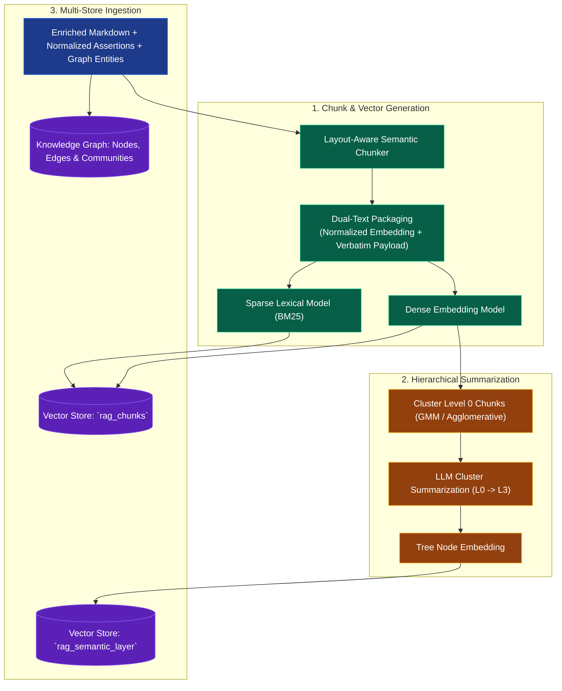
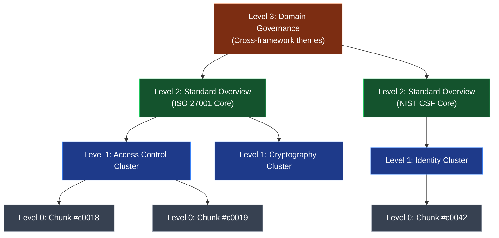

# Stage 3: Chunking, Semantic Tree (RAPTOR) & Storage Encoding

A technical guide for autonomous agents to perform layout-aware semantic chunking, dual-text indexing, hierarchical RAPTOR tree building, and multi-store schema encoding.

**Implementation status:** design guidance. The [implementation plan](./implementation_plan.md) supersedes prototype IDs, fixed vector dimensions, and graph DDL sketches below. Use versioned builds, deterministic Qdrant UUID point IDs, Memgraph-specific tested migrations, and manifest-gated publication. Cross-store atomic deletion is not available.

**Evidence rule:** normalized retrieval text may clarify source context but must not invent obligations or technologies. Generated interpretations and proposed controls are separate records. Embedding profiles and source/build identities are mandatory; sparse retrieval improves lexical recall but cannot guarantee perfect recall.

**Architecture Reference:** [rag_architecture.md](./rag_architecture.md)  
**Upstream Inputs:** [rag_parse.md](./rag_parse.md) (Parsed & Normalized Text) & [rag_extract.md](./rag_extract.md) (Graph Entities)  
**Downstream Retrieval:** [rag_retrieve.md](./rag_retrieve.md) (Broker & Fusion)

---

## 1. Storage Encoding Pipeline Overview



---

## 2. Semantic Chunking & Dual-Text Indexing Strategy

**Agent Role:** `EmbeddingWorker`  
**Reference Code:** [`models.py`](../src/models.py)

### 2.1 Layout-Aware Boundary Detection
Naive token-window chunking breaks tables, sentences, and hierarchical clauses in half. The chunker must:
- Respect structural heading boundaries (`#`, `##`, `###`).
- Keep unrolled table assertions within the same chunk wherever possible.
- Prepend hierarchical breadcrumbs to chunk metadata (`breadcrumb: "ISO27001:2022 > Clause 5 > 5.17 Authentication Information"`).
- Deterministic ID format: `chunk_id = "{doc_id}#c{chunk_index:04d}"`.

### 2.2 Dual-Text Indexing Strategy
Regulatory compliance RAG faces two conflicting demands:
1. **Vector Search:** Needs clean, de-anonymized, atomic sentences for high cosine similarity.
2. **Audit Verification:** Requires exact verbatim quotes with original legal formatting.

**Solution:** Separate the embedding vector from the stored display payload:
- **`dense_text_for_embedding`:** Generated from the normalized, de-anonymized atomic assertion.
- **`verbatim_source_text`:** Exact source passage with character offsets and page coordinates.

```json
{
  "doc_id": "doc_iso27001_2022",
  "chunk_id": "doc_iso27001_2022#c0018",
  "dense_text_for_embedding": "Authentication information: allocation and management shall be controlled by an established management process...",
  "verbatim_source_text": "Allocation and management of authentication information shall be controlled by an established management process...",
  "section_path": "Clause 5: Information security controls > 5.17 Authentication information",
  "page_numbers": [18],
  "entity_ids": ["ent_iso27001"],
  "content_hash": "b2c4e6..."
}
```

### 2.3 Hybrid Embeddings: Dense + Sparse
- **Dense Vectors:** 1536-dimensional or 1024-dimensional semantic embeddings (Cosine distance).
- **Sparse Vectors:** Lexical BM25 or SPLADE token weights improve retrieval of specific clause numbers (`"5.17"`), acronyms (`"FIDO2"`), and defined terms. Evaluate tokenizer behavior and add an exact clause-key lookup; no embedding method guarantees 100% recall.

---

## 3. Hierarchical Semantic Layer (RAPTOR Tree)

**Agent Role:** `TreeBuilder`  
**Reference Code:** [`semantic_tree.py`](../src/semantic_tree.py)

To answer corpus-wide thematic queries (*"Summarize access control governance across all standards"*), lower-level chunks are clustered and summarized recursively into a RAPTOR tree.



### 3.1 Recursive Clustering Algorithm
1. **Level 0:** Raw chunk embeddings are clustered using Gaussian Mixture Models (GMM) with BIC (Bayesian Information Criterion) to select optimal cluster counts.
2. **Summarization:** Each cluster is passed to an LLM to generate an executive summary and descriptive title.
3. **Recursion:** Summaries are embedded and clustered into Level 2, repeating up to root Level 3.
4. **Node Payload Schema:**
   ```json
   {
     "node_id": "doc_iso27001#L1_c02",
     "level": 1,
     "title": "Access Management & Authentication Controls",
     "summary_text": "Specifies multi-factor authentication, privileged account controls, and 15-minute timeout parameters across all operational environments...",
     "parent_node_id": "doc_iso27001#L2_c01",
     "children_node_ids": ["doc_iso27001#c0018", "doc_iso27001#c0019"],
     "leaf_chunk_ids": ["doc_iso27001#c0018", "doc_iso27001#c0019", "doc_iso27001#c0020"]
   }
   ```

---

## 4. Storage Schemas & Indexing Declarations

### 4.1 Vector Store Collections

#### Collection 1: `rag_chunks` (Point Facts)
- **Vector Index:** Dense (1536-d, Cosine similarity, HNSW $M=16$, $ef=100$) + Sparse lexical index (BM25).
- **Payload Indexing:**
  - `doc_id` (Keyword index)
  - `chunk_id` (Keyword index)
  - `entity_ids` (Keyword array index)
  - `section_path` (Text full-text index)

#### Collection 2: `rag_semantic_layer` (Hierarchical RAPTOR Summaries)
- **Vector Index:** Dense (1536-d, Cosine similarity, HNSW $M=24$, $ef=128$).
- **Payload Indexing:**
  - `doc_id` (Keyword index)
  - `level` (Integer index)
  - `parent_node_id` (Keyword index)
  - `leaf_chunk_ids` (Keyword array index)

### 4.2 Knowledge Graph Constraints & Indexes
```
// Uniqueness Constraints
CONSTRAINT entity_id_unique      ON (e:Entity)    REQUIRE e.id IS UNIQUE
CONSTRAINT community_id_unique   ON (c:Community) REQUIRE c.id IS UNIQUE
CONSTRAINT document_id_unique    ON (d:Document)  REQUIRE d.id IS UNIQUE

// Property & Full-Text Indexes
INDEX entity_name_idx    ON (e:Entity)    (e.name)
INDEX entity_type_idx    ON (e:Entity)    (e.type)
INDEX entity_doc_ids_idx ON (e:Entity)    (e.doc_ids)
INDEX community_lvl_idx  ON (c:Community) (c.level)

FULLTEXT_INDEX entity_fulltext_idx ON (e:Entity) (e.name, e.description, e.aliases)
VECTOR_INDEX   entity_vector_idx   ON (e:Entity) (e.embedding) [Metric: Cosine, Dimensions: 1536]
```

---

## 5. Lifecycle Operations at the Storage Layer

**Agent Role:** `LifecycleManager`  
**Reference Code:** [`lifecycle.py`](../src/lifecycle.py)

### 5.1 Differential Ingestion & Hash Fingerprinting
- Ingestion worker queries stored hashes by `doc_id`.
- Reuse content computations only when content and parser/chunker/model/prompt/schema profiles match. Preserve new version-specific provenance and invalidate dependent summaries. Measure cost savings; matching text alone does not justify skipping every downstream stage.

### 5.2 Publication, Invalidation, and Retention
When a document changes, create an immutable build and publish it only after required stages validate; retain the previous version for authorized historical queries. The registry manifest defines visibility across Qdrant and Memgraph.

Deletion first tombstones registry visibility and invalidates dependent summaries, graph assertions, and cache entries by explicit dependency IDs. Physical cleanup is retryable and follows retention/erasure policy. A similarity threshold is not a correct cache-invalidation rule. See the [publication protocol](./implementation_plan.md#visibility-without-a-distributed-transaction).
