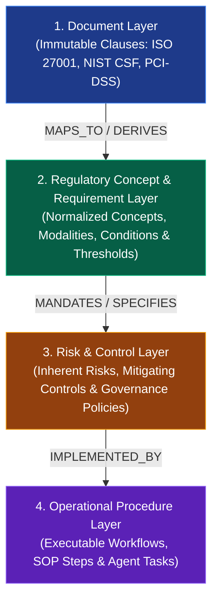
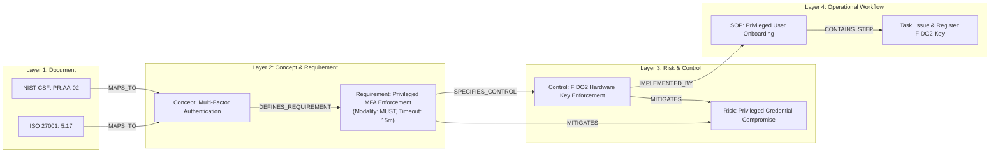

# Stage 2: Knowledge Extraction & Regulatory Graph Modeling

A comprehensive guide for autonomous agents to extract typed entities, construct multi-tier regulatory knowledge graphs, derive risks and controls, and manage audit-safe evolution.

**Implementation status:** target domain model, not the ontology currently implemented by `graph_engine.py`. The [implementation plan](./implementation_plan.md) governs versioned assertions, access scope, publication, and review. Use hosted **Memgraph** with tested Bolt/Cypher compatibility; Neo4j APOC/GDS calls are not portable assumptions. Leiden requires a verified scoped MAGE capability or an offline snapshot job.

**Interpretation boundary:** examples are synthetic, not verified mappings to ISO/NIST requirements. Extract source requirements separately from inferred risks and proposed controls. A control becomes approved organizational policy only after review. Slugs are aliases; tenant, entity type, source context, and resolution decisions determine identity.

**Site documentation extension:** process descriptions and site documents contribute versioned facts about activities, equipment, roles, prerequisites, and operating limits, each carrying source class, scope, and review state. Model `Site`, `Process`, `DocumentSection`, and reviewed requirement-to-site applicability alongside the four-tier model. A template example or draft process statement cannot become an approved fact merely by extraction. Preserve applicable/not-applicable/undetermined decisions with rationale, source spans, and reviewer provenance; unresolved law/permit/process conflicts remain review items.

The Documentation Agent links approved requirements → controls → generated policy/manual/procedure sections, and separately links those sections to supporting site/process facts. Track source, template, and applicability revisions in the dependency ledger. Both legal changes and site/process changes invalidate affected generated sections; outputs retain derivative lineage and cannot prove their own source obligations. DB-031–DB-035 in the [backlog](./coding_tasks.md) define this extension; the ontology examples below remain illustrative and incomplete.

**Architecture Reference:** [rag_architecture.md](./rag_architecture.md)  
**Upstream Input:** [rag_parse.md](./rag_parse.md) (Parsed & Normalized Assertions)  
**Downstream Storage & Retrieval:** [rag_encode.md](./rag_encode.md) & [rag_retrieve.md](./rag_retrieve.md)

---

## 1. The 4-Tier Regulatory Knowledge Architecture

To prevent regulatory churn from breaking business workflows, knowledge is structured across four decoupled, strictly typed layers:



### 1.1 The Decoupling Invariant
> [!IMPORTANT]
> **Operational procedures and controls depend on approved concepts/requirements, not raw clause numbering.** Direct source-provenance links remain allowed for audit; they do not replace the dependency model.
> - Multiple regulatory clauses (e.g., ISO 27001 A.5.17 and NIST CSF PR.AA-02) map to the **same** underlying Concept (`MFA_Enforcement`).
> - Controls satisfy Requirements; Operational Procedures execute Controls.
> - When a standard updates wording or clause numbers, **only the Document $\to$ Concept mapping updates**. Downstream risks, controls, and workflows remain stable until an impact assessment confirms semantic change.

---

## 2. Schema-Guided Entity & Relation Extraction

**Agent Role:** `ExtractAgent`  
**Reference Code:** [`graph_engine.py`](../src/graph_engine.py)

### 2.1 Constrained Ontology
Open extraction produces unconstrained graph hairballs. Agents must strictly extract entities and relations conforming to the ontology:

#### Node Labels
- `(:Clause)`: Specific regulatory or standard section.
- `(:Concept)`: Normalized compliance idea (e.g., *Access Review*, *Data Encryption*).
- `(:Requirement)`: Atomic obligation statement with modality, conditions, and thresholds.
- `(:Risk)`: Threat event or compliance failure mode.
- `(:Control)`: Preventative, detective, or corrective safeguard.
- `(:Workflow)` / `(:TaskStep)`: Standard operating procedure or agent task.
- `(:System)` / `(:Role)` / `(:Asset)`: Operational targets.

#### Relationship Types
```
(:Clause)      -[:MAPS_TO]->              (:Concept)
(:Concept)     -[:DEFINES_REQUIREMENT]->  (:Requirement)
(:Requirement) -[:MITIGATES]->            (:Risk)
(:Requirement) -[:SPECIFIES_CONTROL]->    (:Control)
(:Control)     -[:MITIGATES]->            (:Risk)
(:Control)     -[:IMPLEMENTED_BY]->       (:Workflow)
(:Workflow)    -[:CONTAINS_STEP]->        (:TaskStep)
(:TaskStep)    -[:TARGETS_SYSTEM]->       (:System)
(:TaskStep)    -[:ASSIGNED_TO]->          (:Role)
```

### 2.2 Entity Deduplication & Normalization
- **Legal Suffix & Character Stripping:** Normalize entity names by removing corporate suffixes (`Inc.`, `LLC`, `Corp.`) and converting to canonical slugs (`ent_nist_csf_2_0`).
- **Idempotent Merge:** Ingest nodes using graph `MERGE` semantics, aggregating aliases and appending provenance chunk IDs (`provenance_chunks: [chunk_id]`).

---

## 3. End-to-End Knowledge Modeling Example



### Node Declarations

#### Tier 1: Document Clause Node
```
(:Clause {
  id: "ISO27001_2022#5.17",
  standard: "ISO27001",
  version: "2022",
  clause_num: "5.17",
  title: "Authentication information",
  provenance_doc: "doc_iso27001_2022",
  hash: "a1f8c..."
})
```

#### Tier 2: Concept & Requirement Nodes
```
(:Concept {
  id: "CONCEPT_MFA",
  name: "Multi-Factor Authentication",
  domain: "Identity and Access Management"
})

(:Requirement {
  id: "REQ_PRIV_MFA",
  modality: "MUST",
  statement: "Privileged accounts must require multi-factor hardware authentication.",
  threshold: "15_minute_timeout",
  exception: "Break_glass_vault"
})
```

#### Tier 3: Risk & Control Nodes
```
(:Risk {
  id: "RISK_PRIV_TAKEOVER",
  name: "Privileged Account Takeover",
  category: "Access Control Failure",
  severity: "HIGH"
})

(:Control {
  id: "CTRL_IAM_042",
  name: "Enforce Hardware MFA for Privileged Users",
  control_type: "PREVENTATIVE",
  enforcement_level: "MANDATORY"
})
```

#### Tier 4: Operational Workflow Nodes
```
(:Workflow {
  id: "WF_USER_ONBOARDING",
  name: "Privileged User Onboarding SOP",
  owner: "IAM Team"
})

(:TaskStep {
  id: "WF_STEP_03",
  sequence: 3,
  action: "Register FIDO2 Token in Identity Provider",
  responsible_role: "Security Administrator"
})
```

---

## 4. Community Detection & Hierarchical Graph Summaries

To support global thematic queries (*"What are the recurring operational risks across APAC subsidiaries?"*), the extraction worker executes the **Leiden Community Detection Algorithm**:
1. Groups interconnected entities into hierarchical communities (Levels 0, 1, 2).
2. Generates LLM-synthesized community summary nodes:
   ```
   (:Community {
     id: "COMM_IAM_GLOBAL",
     level: 1,
     title: "Identity & Access Governance",
     summary: "Comprehensive synthesis of authentication, session timeouts, and role provisioning across all ingested frameworks...",
     embedding: [0.014, -0.052, ...]
   })
   ```

---

## 5. Knowledge Evolution, Versioning & Impact Propagation

**Agent Role:** `LifecycleAgent`  
**Reference Code:** [`lifecycle.py`](../src/lifecycle.py)

### 5.1 The Immutability Principle
> [!CAUTION]
> **Never update nodes in place.**
> When standards update, altering existing nodes destroys audit trails and invalidates past compliance certifications. Instead, create versioned states and link them with evolutionary edges.

### 5.2 Versioning Model: Stable Identities + Versioned States
```
(MFA_Concept:Concept)
       │
       ├──[:HAS_VERSION]──> (State_v1 {version: "1.0", definition: "...", valid_to: "2024-01-01"})
       │
       └──[:HAS_ACTIVE_VERSION]──> (State_v2 {version: "2.0", definition: "...", valid_from: "2024-01-01"})
```

### 5.3 Change Taxonomy
When a revised standard is ingested, changes are classified into three impact categories:

| Change Class | Definition | Example | Pipeline Action |
| :--- | :--- | :--- | :--- |
| **`NON_BREAKING`** | Editorial clarifications or wording tweaks with identical obligations. | Wording typo corrected; guidance note added. | Update Document $\to$ Concept mapping. Downstream verified. |
| **`DEPRECATION`** | Clause renumbered or slated for retirement with a transition period. | ISO 27001:2013 A.9.4.2 replaced by 2022 5.17. | Add `DEPRECATED_BY` edge. Rules remain active until sunset date. |
| **`BREAKING`** | Modality shift (`SHOULD` $\to$ `MUST`), tightened thresholds, or new obligations. | MFA made mandatory for all internal consoles; timeout reduced to 15m. | Create new Concept/Requirement version. **Trigger Impact Traversal.** |

### 5.4 Automated Impact Traversal Query
When a `BREAKING` change is detected, the agent executes downstream dependency traversal:

```
MATCH path = (c:Clause {id: $changed_clause_id})
             -[:MAPS_TO]->(concept:Concept)
             -[:DEFINES_REQUIREMENT]->(req:Requirement)
             -[:SPECIFIES_CONTROL]->(ctrl:Control)
             -[:IMPLEMENTED_BY]->(wf:Workflow)
RETURN concept.id, req.id, ctrl.id, wf.id
```

### 5.5 The "Needs Review" Quarantine Protocol
1. Downstream controls and workflows in the traversal path are tagged with `status: "NEEDS_REVIEW"`.
2. The agent generates an **Impact Assessment Ticket**:
   - Exact delta between old and new clause requirements.
   - List of affected Controls, Risks, and Operational SOPs.
   - Recommended procedural updates.
3. **No operational workflow or control is automatically changed in production without human compliance officer sign-off.**
4. Generated document packages with changed dependencies become `needs_review`; retain previous content, surface affected sections and a proposed diff, and obtain site/process plus compliance review (and competent technical review for safety-critical content). Do not silently update `assets/publish`, replace human edits, or continue to present stale packages as current validated guidance. Review and export use the shared registry contracts in the implementation plan.
