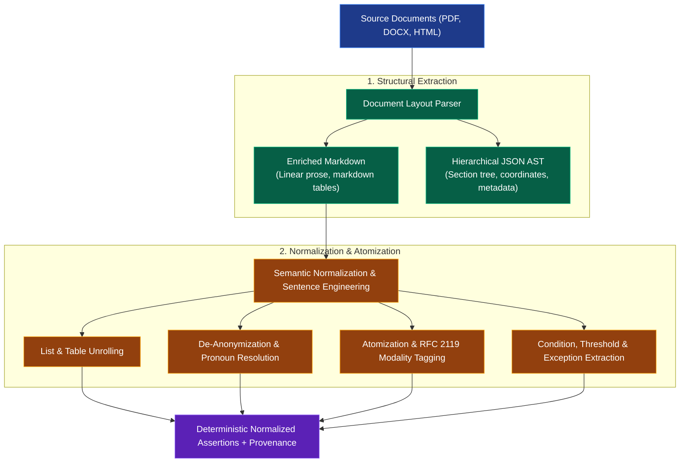

# Stage 1: Document Parsing & Semantic Normalization

A detailed engineering guide for autonomous agents to ingest raw regulatory documents, preserve structural hierarchy, unroll complex formats, and engineer deterministic semantic assertions.

**Architecture Reference:** [rag_architecture.md](./rag_architecture.md)  
**Next Stage:** [rag_extract.md](./rag_extract.md) (Knowledge Extraction) & [rag_encode.md](./rag_encode.md) (Embedding & Indexing)

---

## 1. Overview & Pipeline Flow

The parsing phase converts unstructured, layout-dense files (PDF, DOCX, HTML) into clean, unambiguous representations ready for graph extraction and vector embedding.



---

## 2. Structural Parsing & Dual Representation

**Agent Role:** `ParseAgent`

### 2.1 Dual Output Contract
To balance readability for LLM reasoning with strict AST hierarchy for downstream indexing, the parser produces two synchronized outputs:

1. **Enriched Markdown:** Preserves linear reading order, markdown table syntax, and header levels (`#`, `##`, `###`) for breadcrumb construction (`"Clause 5 > 5.17 Authentication Information"`).
2. **Hierarchical JSON (AST):** Encapsulates the entire structural tree, exact clause keys, nested section spans, and page/bounding-box coordinates.

```json
{
  "doc_id": "doc_iso27001_2022",
  "source_uri": "s3://compliance-vault/iso27001_2022.pdf",
  "standard": "ISO/IEC 27001",
  "version": "2022",
  "nodes": [
    {
      "node_id": "ISO27001_2022#5.17",
      "clause_num": "5.17",
      "title": "Authentication information",
      "hierarchy": ["Clause 5: Information security controls", "5.17 Authentication information"],
      "page_numbers": [18],
      "bounding_boxes": [{"page": 18, "x1": 72.0, "y1": 140.0, "x2": 520.0, "y2": 260.0}],
      "raw_text": "Allocation and management of authentication information shall be controlled by a management process...",
      "content_hash": "a1f8c49e7b2d..."
    }
  ]
}
```

### 2.2 Ingestion Rules for Parsing Agents
- **Preserve Canonical Clause Identifiers:** Never replace standard numbering (`5.17`, `PR.AA-02`, `Req 8.3.1`) with synthetic IDs. Canonical strings serve as cross-framework anchors.
- **Record Provenance Coordinates:** Retain `page_numbers`, `char_start`, and `char_end` for legal citations and audit verification.
- **Strip Formatting Noise:** Strip running headers, footers, pagination numbers, and decorative styling while retaining semantic bolding of defined terms.

---

## 3. Markdown Normalization & Sentence Engineering

**Agent Role:** `EnrichAgent`

Raw regulatory text is intentionally verbose, legalistic, and relies heavily on nested lists and tables. The normalization agent decomposes these structures into independent, self-contained assertions.

### 3.1 Table and List Unrolling
Tables and bulleted lists lose their relational context when chunked naively. Agents must unroll them into independent, complete sentences that inherit all parent header context.

#### Example: Unrolling a Regulatory Table
**Raw Table:**
| Role | Authentication Factor | Max Session Inactivity |
| :--- | :--- | :--- |
| Standard User | Password + OTP | 30 minutes |
| System Administrator | FIDO2 Hardware Token | 15 minutes |

**Agent Normalized Assertions:**
```markdown
- Standard users MUST authenticate using multi-factor authentication consisting of a password and a one-time password (OTP).
- Standard user sessions MUST be terminated after a maximum of 30 minutes of inactivity.
- System administrators MUST authenticate using multi-factor authentication consisting of a FIDO2 hardware token.
- System administrator sessions MUST be terminated after a maximum of 15 minutes of inactivity.
```

### 3.2 Semantic De-Anonymization & Disambiguation
- **Pronoun & Ellipsis Resolution:** Replace vague pronouns (*"it"*, *"they"*, *"such organizations"*) with the explicit canonical entity (*"The Cloud Service Provider (CSP)"*).
- **Inline Glossary Expansion:** Expand defined terms on first appearance in every chunk using the standard's glossary (e.g., `"PII"` $\to$ `"Personally Identifiable Information (PII)"`).
- **Citation Canonicalization:** Convert relative references (*"as outlined in section (b) above"*) into absolute canonical links (*"as outlined in ISO27001:2022 Clause 5.15.2"*).

### 3.3 Sentence Atomization & Modality Tagging
Split compound sentences into atomic units containing exactly one requirement. Tag each sentence with its formal normative modality:

| Modality Tag | RFC 2119 Keywords | Regulatory Meaning | Action for Risk & Control |
| :--- | :--- | :--- | :--- |
| **`MUST`** | *shall, must, required* | Mandatory Obligation | Generates a mandatory preventative/detective Control. |
| **`MUST_NOT`**| *shall not, must not, prohibited* | Absolute Prohibition | Generates a hard preventative boundary Control. |
| **`SHOULD`** | *should, recommended* | Strong Expectation | Generates a standard Control; deviations require formal risk acceptance. |
| **`MAY`** | *may, optional, permitted* | Permissive Guideline | Documented as an optional implementation option. |

> [!NOTE]
> Non-normative explanatory text, notes, and examples must be segregated from normative obligations using metadata flags (`is_normative: false`).

### 3.4 Condition, Exception & Threshold Extraction
Agents extract conditions, numerical thresholds, and exceptions into a structured metadata tuple:

```json
{
  "assertion_id": "AST-ISO-5.17-01",
  "clause_id": "ISO27001_2022#5.17",
  "actor": "System Administrator",
  "action": "Authenticate to privileged consoles",
  "modality": "MUST",
  "factors_required": ["KnowledgeFactor", "PossessionFactor"],
  "threshold": {
    "session_timeout_minutes": 15,
    "max_failed_attempts": 5
  },
  "condition": "When accessing production or cardholder data environments",
  "exceptions": ["Break-glass emergency accounts stored in physical access vaults"],
  "is_normative": true
}
```

---

## 4. Pipeline Handoff Specifications

Once parsing and normalization are complete, the resulting artifacts are dispatched downstream:

| Artifact | Downstream Consumer | Purpose |
| :--- | :--- | :--- |
| **Normalized Assertions & Tuples** | [rag_extract.md](./rag_extract.md) | Entity, relation, and concept graph extraction; risk and control derivation. |
| **Atomic Sentences & Verbatim Text** | [rag_encode.md](./rag_encode.md) | Layout-aware chunking, hybrid vector embeddings, and RAPTOR tree summarization. |
| **Hierarchical JSON AST** | [rag_encode.md](./rag_encode.md) | Provenance coordinate anchoring and payload metadata indexing. |