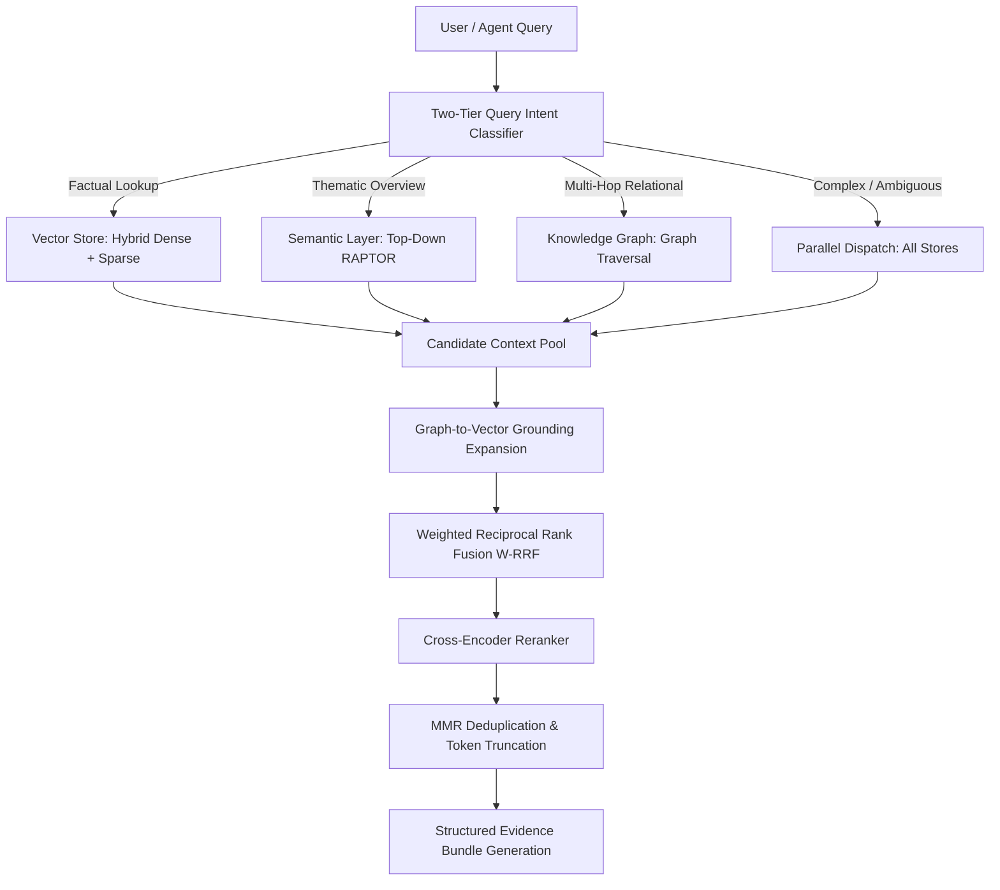
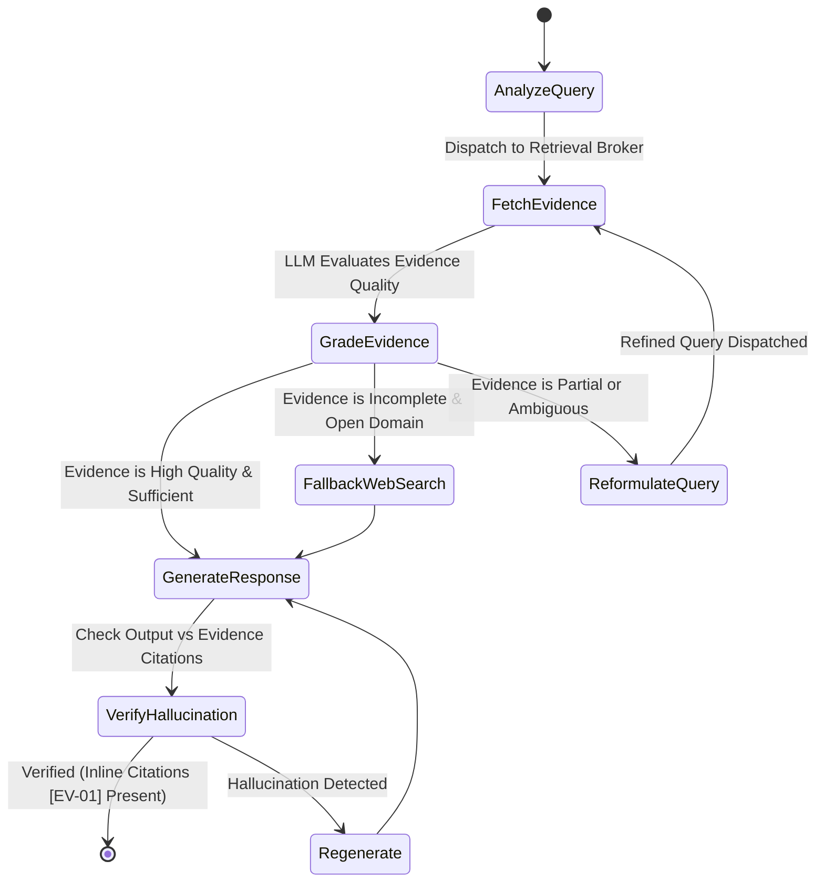

# Stage 4: Query Routing, Multi-Index Retrieval, Fusion & Agentic CRAG

A technical guide for agents to retrieve regulatory, process, and site evidence, build grounded answers, and generate site-specific policy/manual/procedure packages through the Documentation Agent.

**Implementation status:** target behavior, not an end-to-end implemented broker. The [implementation plan](./implementation_plan.md) governs API contracts, authorization, manifest/version selection, score semantics, and evaluation. LangChain tools and LangGraph answering/review workflows live in this repository. Hosted Memgraph supplies graph storage; it does not own agent execution.

**Workflow limits:** initially allow at most two corrective retrieval rounds and one answer-repair round within a total budget. Return partial/insufficient evidence explicitly. Automatic web-search fallback is disabled; the older diagram below shows a possible future opt-in connector. Citation existence and source support are separate checks, and unchecked streamed text must not be labelled verified.

**Documentation requests:** use the same authorized broker but a separate checkpointed generation workflow, not the ordinary Q&A response path. Bind tenant/site/process and source roles before retrieval; templates and generated derivatives cannot become legal or site-fact authority. Long manuals use bounded per-section retrieval and package-wide budgets. See Section 8 and the [plan](./implementation_plan.md#documentation-agent-workflow-retrieve) for review/export contracts.

**Architecture Reference:** [rag_architecture.md](./rag_architecture.md)  
**Upstream Storage:** [rag_encode.md](./rag_encode.md) (Vector & RAPTOR) & [rag_extract.md](./rag_extract.md) (Knowledge Graph)

---

## 1. Retrieval Broker Architecture

The central **Retrieval Broker** coordinates intent-driven routing, multi-store candidate retrieval, cross-grounding expansion, reciprocal rank fusion, and token-budget compression.



---

## 2. Two-Tier Adaptive Query Routing

**Agent Role:** `QueryRouter`  
**Reference Code:** [`router.py`](../src/router.py)

Querying all three stores increases work and can add noisy context; parallel dispatch does not inherently triple latency. Measure end-to-end latency and cost. The router applies a two-tier evaluation strategy:

1. **Tier 1 (Sub-millisecond Rule Matcher):** Evaluates regex heuristics for obvious patterns (e.g., *"summarize"*, *"main themes"* $\to$ `THEMATIC_SUMMARY`; *"how is X related to Y"* $\to$ `MULTI_HOP_RELATIONAL`; *"section 4.2"*, *"clause"* $\to$ `FACTUAL_LOOKUP`).
2. **Tier 2 (Structured LLM Classifier):** Complex queries are dispatched to an LLM router returning a structured intent enum with confidence scores.
3. **Adaptive Fallback:** If the primary store returns results below a confidence threshold ($\tau < 0.68$), the broker dynamically escalates to parallel multi-store retrieval.

| Query Intent | Target Store | Typical Query Structure & Example |
| :--- | :--- | :--- |
| **`FACTUAL_LOOKUP`** | Vector Store (`rag_chunks`) | Specific clauses, numbers, or facts (*"What is the penalty under clause 8.1?"*). |
| **`THEMATIC_SUMMARY`** | Semantic Layer (`rag_semantic_layer`) | Broad corporate themes (*"Summarize the Q3 corporate compliance pivot"*). |
| **`MULTI_HOP_RELATIONAL`** | Knowledge Graph | Non-contiguous relational links (*"Which APAC suppliers serve facilities affected by outage X?"*). |
| **`GLOBAL_CORPUS`** | Graph Communities + L3 Tree Nodes | Corpus-wide risk trends (*"What recurring compliance risks exist across all subsidiaries?"*). |
| **`COMPLEX_HYBRID`** | Parallel Retrieval (All Stores) | Multi-faceted questions (*"Compare policy differences between Branch A and B regarding GDPR"*). |

---

## 3. Search Execution Strategies Across Stores

### 3.1 Vector Store Hybrid Lookup (`rag_chunks`)
Executes dense vector search (semantic similarity) and sparse lexical search (BM25 token match) concurrently, merging candidates using linear reciprocal score normalization.

### 3.2 Semantic Layer Top-Down Search Pruning (`rag_semantic_layer`)
**Reference Code:** [`semantic_tree.py`](../src/semantic_tree.py)
1. Query matches high-level root nodes (Level 2/3).
2. The broker collects `leaf_chunk_ids` from matched summary roots.
3. Restricts Level 0 chunk search to candidate IDs within the authorized manifest. Measure recall against unrestricted retrieval; allow a bounded fallback when summary pruning misses evidence.

### 3.3 Knowledge Graph Traversal
Executes multi-hop Cypher queries to extract connected paths between queried entities:
```cypher
MATCH path = (e1:Entity {name: $source})-[:RELATION*1..3]-(e2:Entity {name: $target})
RETURN path, [n in nodes(path) | n.provenance_chunks] as chunks
LIMIT 10
```

---

## 4. Cross-Grounding & Multi-Index Fusion

**Agent Role:** `RetrievalBroker`  
**Reference Code:** [`broker_fusion.py`](../src/broker_fusion.py)

### 4.1 Graph-to-Vector Grounding Expansion
Graph paths provide structural context but lack full legal text. The broker extracts `provenance_chunks` attached to returned graph nodes and edges and retrieves the raw text passages directly from the Vector Store by primary key, bypassing secondary vector index scans.

### 4.2 Weighted Reciprocal Rank Fusion (W-RRF)
Distance metrics differ fundamentally across stores (cosine similarity vs. graph path weights vs. tree parent relevance). The broker normalizes and fuses candidates using W-RRF:

$$W\_RRF(d \in D) = \sum_{m \in M} w_m \cdot \frac{1}{k + r_m(d)}$$

- $M = \{\text{VectorStore}, \text{SemanticLayer}, \text{KnowledgeGraph}\}$.
- $w_m$ is the dynamic store weight conditioned on query intent (e.g., $w_{graph}=1.5$ for relational intents).
- $k$ is the smoothing constant (default: $60$).
- $r_m(d)$ is the 1-indexed rank position of item $d$ in store $m$.

### 4.3 Cross-Encoder Re-ranking & Token Budgeting
- The top candidates may be evaluated by a **Cross-Encoder Re-ranker**. Record provider score semantics; raw scores and normalized RRF values are not calibrated probabilities. Tune thresholds on held-out data, not a universal confidence constant.
- Candidates undergo Maximal Marginal Relevance (MMR) deduplication.
- Content is packaged into the final Evidence Bundle adhering strictly to the token budget (default: 3,500 tokens).

---

## 5. Structured Evidence Bundle Specification

The broker compiles a strictly typed JSON payload passed to the downstream generation agent:

```json
{
  "query": "Which subsidiaries in APAC are subject to strict data retention policies?",
  "intent": "complex_hybrid",
  "evidence": [
    {
      "citation_id": "EV-01",
      "source_store": "KnowledgeGraph",
      "type": "entity_relationship_path",
      "content": "Subsidiary [TechCorp APAC] located in [Singapore] governed by [Telemetry Mandate 2026].",
      "confidence": 0.942,
      "graph_path": ["TechCorp APAC", "LOCATED_IN", "Singapore", "GOVERNED_BY", "Telemetry Mandate 2026"],
      "supporting_chunks": ["doc_sg_policy#c0014"]
    },
    {
      "citation_id": "EV-02",
      "source_store": "VectorStore",
      "type": "exact_excerpt",
      "content": "Section 4.2: Customer telemetry collected in Singapore must be retained for 7 years...",
      "confidence": 0.915,
      "metadata": {
        "doc_id": "doc_sg_policy",
        "chunk_id": "doc_sg_policy#c0014",
        "section": "Data Retention Policy > Section 4.2",
        "page_numbers": [14]
      }
    },
    {
      "citation_id": "EV-03",
      "source_store": "SemanticLayer",
      "type": "macro_summary",
      "content": "Executive Summary: APAC Regulatory Harmonization 2026...",
      "confidence": 0.865,
      "metadata": {
        "level": 2,
        "node_id": "doc_apac_overview#L2_c01"
      }
    }
  ],
  "provenance_summary": {
    "total_sources_fused": 3,
    "conflicting_facts_detected": false
  }
}
```

---

## 6. Agentic Orchestration & Corrective RAG (CRAG)

Downstream answer generation utilizes a stateful agent loop executing a Corrective RAG workflow:



1. **Grade Evidence:** Agent verifies whether the Evidence Bundle directly answers all sub-facets of the query.
2. **Dynamic Query Reformulation:** If evidence is partial, reformulates targeted sub-queries to retrieve missing facts.
3. **Hallucination Verification:** Enforces that every assertion in the final synthesis maps to a valid `citation_id` (`[EV-01]`, `[EV-02]`).

---

## 7. REST API & Latency Budget

### 7.1 Query Endpoint: `POST /v1/retrieval/query`

**Request:**
```json
{
  "query": "What are the penalties under the Singapore telemetry mandate and which units are affected?",
  "override_intent": null,
  "max_tokens": 4000,
  "rerank_top_n": 10
}
```

### 7.2 Measured Latency and Cost Budgets

The earlier 160 ms broker estimate was not benchmarked and did not account reliably for hosted model calls. Instrument routing, embeddings, per-store search, grounding, reranking, synthesis, and verification separately.

Use the [plan's provisional release budgets](./implementation_plan.md#8-evaluation-and-release-criteria): p95 under 3 seconds for evidence retrieval and under 20 seconds for a normal verified answer, subject to validation at a declared corpus size, concurrency, region, and model profile. Corrective rounds have a separate bounded budget. Publish measured p50/p95, token usage, and cost; do not present these provisional targets as existing SLAs.

## 8. Documentation Agent within RETRIEVE

**Planned implementation:** `workflows/documentation.py` orchestrates LangChain model/tool calls via LangGraph; `documentation.py` validates/renders packages and prepares controlled exports. Reuse the broker, source resolver, jobs, registry, and review contracts. No second vector index or independent agent service is needed.

### 8.1 Inputs and evidence separation

A request identifies an authorized site/process, as-of date, document types (policy, manual, procedure), template revisions, and optional prior package. Tenant identity and permitted scope come from trusted context. Pin source/site/process revisions and separately retrieve:

1. Regulatory obligations, permits, standards, and guidance, with their distinct authority and applicability status.
2. Process steps, site roles/equipment, approved operating limits, and existing organizational requirements, with exact revision and review state.
3. Templates for layout and existing draft/generated documents for explicitly labelled reference or revision comparison, not independent authority.

Each section bundle includes source class/status, site/process scope, immutable spans, reviewed applicability decision IDs, missing/conflicting facts, and dependencies. Dense/sparse, graph expansion, summaries, and direct fetches enforce the same filters. Compression cannot discard a limit's unit, exception, prerequisite, or source role. An unavailable site licence or rule stays a gap; regulatory text and internal preferences are never merged simply because their wording is similar.

### 8.2 Drafting and validation

Plan a package outline and stable document IDs, then draft sections using a shared role/terminology register and obligation-to-section coverage map. Policy states commitments and accountabilities; manual explains the management system and links its procedures; procedures specify supported roles, prerequisites, steps, hold points, records, and escalation paths. This describes document structure, not permission to invent missing operational content.

Every substantive statement must have immutable support or be marked as a proposed organizational control. Preserve uncertainties such as `torque x` and `[TBC]`; templates' example values are not defaults. Check evidence support, numeric/unit/modality fidelity, regulatory applicability, cross-document consistency, resolvable links, and critical gaps before requesting review. Source status can permit a provisional draft while still blocking operational approval. Budgeted retrieval/repair loops end with actionable gaps, not endless attempts to fill them from model memory.

For the supplied P-001/WI-007 drafts, do not infer confirmed emergency locations, alarm settings, permit conditions, or manufacturer limits. The Recycling Act alone does not prove which duties apply at the site. D01–D10 in the [backlog](./coding_tasks.md#documentation-examples-and-acceptance-scenarios) cover these failure cases and a corrected synthetic positive case.

### 8.3 Review, export, and later changes

Use the existing authenticated approval API and LangGraph interrupts for site/process and compliance review, plus competent technical review of safety-critical content. Decisions bind the exact content/dependency hashes. Missing critical evidence, changed inputs, rejected proposals, or revoked reviewer permissions prevent publication; a source instruction or model judge cannot approve anything.

The application exports Markdown packages under `assets/publish/<tenant-id>/<site-id>/<package-id>/<revision>/` with a manifest, evidence map, and review/gap record. Draft exports carry a not-for-operational-use label and are never current approved output. Staged complete exports become current only through the registry after approval and current-dependency checks; the model does not write files. Preserve supplied examples and previous revisions. Source updates mark dependent packages needs-review and generate a diff proposal; no silent regeneration or automatic ingestion of generated files. Artifact downloads recheck scope and revocation. Full API and filesystem contracts are defined in the implementation plan; PDF/DOCX export and external distribution are not initial requirements.
