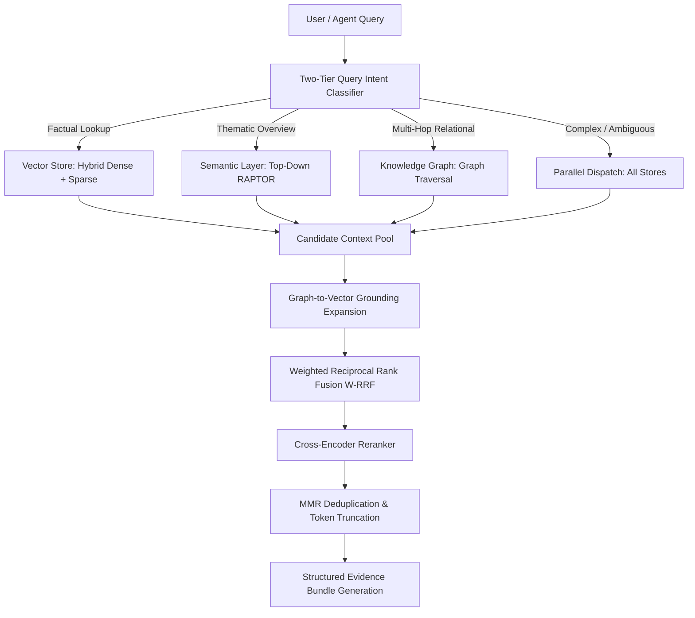
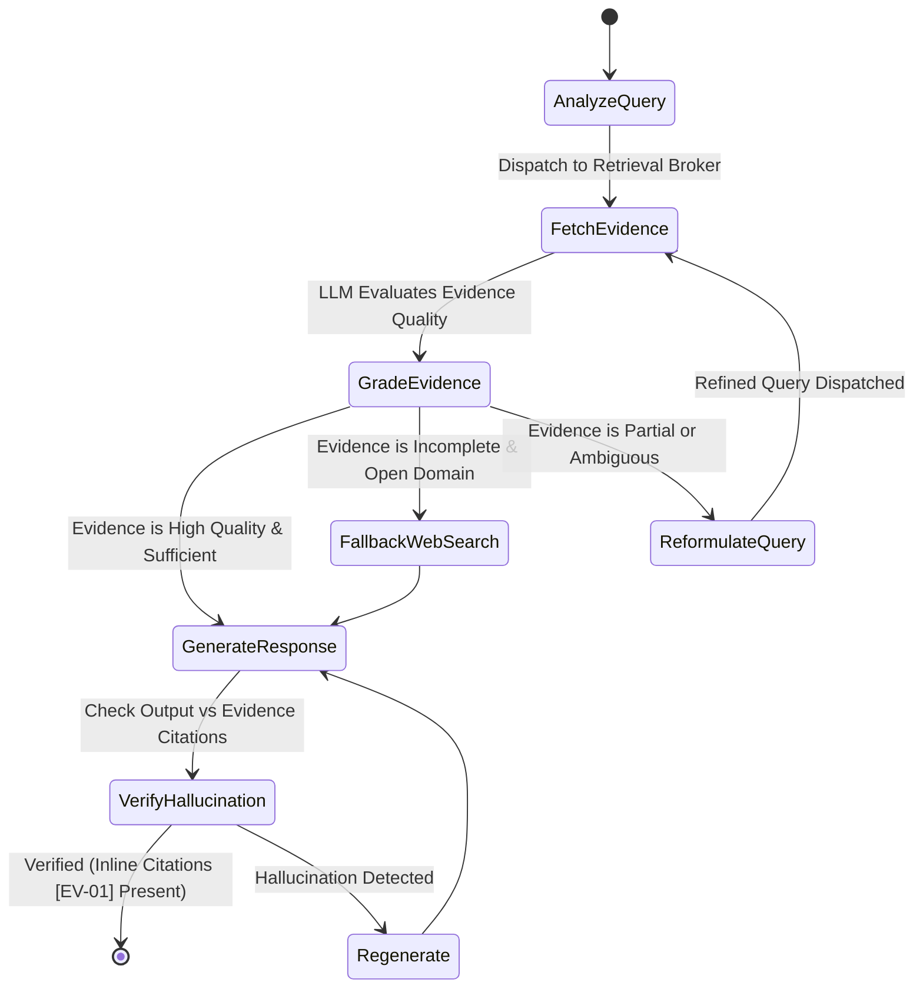

# Stage 4: Query Routing, Multi-Index Retrieval, Fusion & Agentic CRAG

A comprehensive technical guide for autonomous agents to route incoming compliance queries, retrieve across tri-focal representations, fuse disparate scores, build structured evidence bundles, and execute Corrective RAG (CRAG).

**Architecture Reference:** [rag_architecture.md](./rag_architecture.md)  
**Upstream Storage:** [rag_encode.md](./rag_encode.md) (Vector & RAPTOR) & [rag_extract.md](./rag_extract.md) (Knowledge Graph)

---

## 1. Retrieval Broker Architecture

The central **Retrieval Broker** coordinates intent-driven routing, multi-store candidate retrieval, cross-grounding expansion, reciprocal rank fusion, and token-budget compression.



---

## 2. Two-Tier Adaptive Query Routing

**Agent Role:** `QueryRouter`  
**Reference Code:** [`router.py`](../src/router.py)

Querying all three stores blindly incurs a 3x latency penalty, unnecessary token costs, and noisy context. The router applies a two-tier evaluation strategy:

1. **Tier 1 (Sub-millisecond Rule Matcher):** Evaluates regex heuristics for obvious patterns (e.g., *"summarize"*, *"main themes"* $\to$ `THEMATIC_SUMMARY`; *"how is X related to Y"* $\to$ `MULTI_HOP_RELATIONAL`; *"section 4.2"*, *"clause"* $\to$ `FACTUAL_LOOKUP`).
2. **Tier 2 (Structured LLM Classifier):** Complex queries are dispatched to an LLM router returning a structured intent enum with confidence scores.
3. **Adaptive Fallback:** If the primary store returns results below a confidence threshold ($\tau < 0.68$), the broker dynamically escalates to parallel multi-store retrieval.

| Query Intent | Target Store | Typical Query Structure & Example |
| :--- | :--- | :--- |
| **`FACTUAL_LOOKUP`** | Vector Store (`rag_chunks`) | Specific clauses, numbers, or facts (*"What is the penalty under clause 8.1?"*). |
| **`THEMATIC_SUMMARY`** | Semantic Layer (`rag_semantic_layer`) | Broad corporate themes (*"Summarize the Q3 corporate compliance pivot"*). |
| **`MULTI_HOP_RELATIONAL`** | Knowledge Graph | Non-contiguous relational links (*"Which APAC suppliers serve facilities affected by outage X?"*). |
| **`GLOBAL_CORPUS`** | Graph Communities + L3 Tree Nodes | Corpus-wide risk trends (*"What recurring compliance risks exist across all subsidiaries?"*). |
| **`COMPLEX_HYBRID`** | Parallel Retrieval (All Stores) | Multi-faceted questions (*"Compare policy differences between Branch A and B regarding GDPR"*). |

---

## 3. Search Execution Strategies Across Stores

### 3.1 Vector Store Hybrid Lookup (`rag_chunks`)
Executes dense vector search (semantic similarity) and sparse lexical search (BM25 token match) concurrently, merging candidates using linear reciprocal score normalization.

### 3.2 Semantic Layer Top-Down Search Pruning (`rag_semantic_layer`)
**Reference Code:** [`semantic_tree.py`](../src/semantic_tree.py)
1. Query matches high-level root nodes (Level 2/3).
2. The broker collects `leaf_chunk_ids` from matched summary roots.
3. Restricts Level 0 chunk search strictly to candidate IDs, **pruning over 95% of irrelevant chunks** before vector calculation.

### 3.3 Knowledge Graph Traversal
Executes multi-hop Cypher queries to extract connected paths between queried entities:
```cypher
MATCH path = (e1:Entity {name: $source})-[:RELATION*1..3]-(e2:Entity {name: $target})
RETURN path, [n in nodes(path) | n.provenance_chunks] as chunks
LIMIT 10
```

---

## 4. Cross-Grounding & Multi-Index Fusion

**Agent Role:** `RetrievalBroker`  
**Reference Code:** [`broker_fusion.py`](../src/broker_fusion.py)

### 4.1 Graph-to-Vector Grounding Expansion
Graph paths provide structural context but lack full legal text. The broker extracts `provenance_chunks` attached to returned graph nodes and edges and retrieves the raw text passages directly from the Vector Store by primary key, bypassing secondary vector index scans.

### 4.2 Weighted Reciprocal Rank Fusion (W-RRF)
Distance metrics differ fundamentally across stores (cosine similarity vs. graph path weights vs. tree parent relevance). The broker normalizes and fuses candidates using W-RRF:

$$W\_RRF(d \in D) = \sum_{m \in M} w_m \cdot \frac{1}{k + r_m(d)}$$

- $M = \{\text{VectorStore}, \text{SemanticLayer}, \text{KnowledgeGraph}\}$.
- $w_m$ is the dynamic store weight conditioned on query intent (e.g., $w_{graph}=1.5$ for relational intents).
- $k$ is the smoothing constant (default: $60$).
- $r_m(d)$ is the 1-indexed rank position of item $d$ in store $m$.

### 4.3 Cross-Encoder Re-ranking & Token Budgeting
- The top 25 fused candidates are evaluated by a **Cross-Encoder Re-ranker**, producing calibrated $[0.0 - 1.0]$ relevance scores.
- Candidates undergo Maximal Marginal Relevance (MMR) deduplication.
- Content is packaged into the final Evidence Bundle adhering strictly to the token budget (default: 3,500 tokens).

---

## 5. Structured Evidence Bundle Specification

The broker compiles a strictly typed JSON payload passed to the downstream generation agent:

```json
{
  "query": "Which subsidiaries in APAC are subject to strict data retention policies?",
  "intent": "complex_hybrid",
  "evidence": [
    {
      "citation_id": "EV-01",
      "source_store": "KnowledgeGraph",
      "type": "entity_relationship_path",
      "content": "Subsidiary [TechCorp APAC] located in [Singapore] governed by [Telemetry Mandate 2026].",
      "confidence": 0.942,
      "graph_path": ["TechCorp APAC", "LOCATED_IN", "Singapore", "GOVERNED_BY", "Telemetry Mandate 2026"],
      "supporting_chunks": ["doc_sg_policy#c0014"]
    },
    {
      "citation_id": "EV-02",
      "source_store": "VectorStore",
      "type": "exact_excerpt",
      "content": "Section 4.2: Customer telemetry collected in Singapore must be retained for 7 years...",
      "confidence": 0.915,
      "metadata": {
        "doc_id": "doc_sg_policy",
        "chunk_id": "doc_sg_policy#c0014",
        "section": "Data Retention Policy > Section 4.2",
        "page_numbers": [14]
      }
    },
    {
      "citation_id": "EV-03",
      "source_store": "SemanticLayer",
      "type": "macro_summary",
      "content": "Executive Summary: APAC Regulatory Harmonization 2026...",
      "confidence": 0.865,
      "metadata": {
        "level": 2,
        "node_id": "doc_apac_overview#L2_c01"
      }
    }
  ],
  "provenance_summary": {
    "total_sources_fused": 3,
    "conflicting_facts_detected": false
  }
}
```

---

## 6. Agentic Orchestration & Corrective RAG (CRAG)

Downstream answer generation utilizes a stateful agent loop executing a Corrective RAG workflow:



1. **Grade Evidence:** Agent verifies whether the Evidence Bundle directly answers all sub-facets of the query.
2. **Dynamic Query Reformulation:** If evidence is partial, reformulates targeted sub-queries to retrieve missing facts.
3. **Hallucination Verification:** Enforces that every assertion in the final synthesis maps to a valid `citation_id` (`[EV-01]`, `[EV-02]`).

---

## 7. REST API & Latency Budget

### 7.1 Query Endpoint: `POST /v1/retrieval/query`

**Request:**
```json
{
  "query": "What are the penalties under the Singapore telemetry mandate and which units are affected?",
  "override_intent": null,
  "max_tokens": 4000,
  "rerank_top_n": 10
}
```

### 7.2 Latency Budget Breakdown

| Operation Stage | Target SLA | Description |
| :--- | :--- | :--- |
| **Intent Classification** | $\le 15\text{ ms}$ | Heuristic check ($\le 1\text{ ms}$) or fast LLM router. |
| **Parallel Store Retrieval** | $\le 45\text{ ms}$ | Concurrent queries against Vector Store, Semantic Layer, and Graph. |
| **Grounding Expansion & Fusion** | $\le 10\text{ ms}$ | ID resolution, W-RRF scoring, candidate pooling. |
| **Cross-Encoder Re-ranking** | $\le 65\text{ ms}$ | Batch cross-attention re-scoring over top 25 candidates. |
| **Total Broker Latency** | **$\le 160\text{ ms}$** | Generates verified Evidence Bundle ready for generation. |
