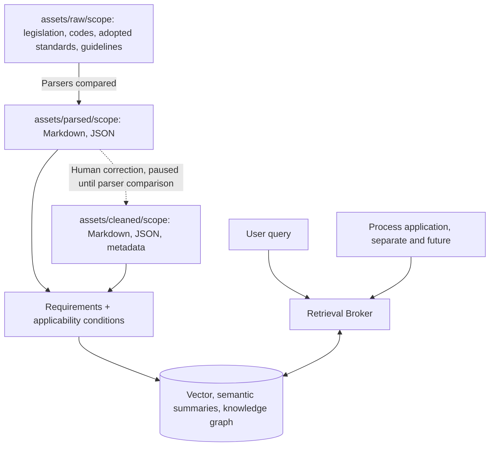

# Place for working on Ideas, between Humans and Agents

**Note for agents:** Humans will add a new ideas to [Whiteboard](#whiteboard). Agents add details, identify strengths and weaknesses against existing project [docs](../docs/), confirm uncertainities / requirements from humans. After human approval, integrate the ideas into [implementation_plan](implementation_plan.md), [coding_tasks](./coding_tasks.md) and [docs](../docs/). After integration, clean the [Whiteboard](#whiteboard)

## Whiteboard

Empty. The previous idea (separating regulatory and process knowledge) was integrated on 2026-10-26. Process application material is in [process_pipeline_future](./process_pipeline_future/README.md).

### Regulatory pipeline after separation

Scope codes are dotted and hierarchical: `GLOBAL` → `GLOBAL.AU` → `GLOBAL.AU.VIC` → `GLOBAL.AU.VIC.AUWOD`. A location inherits every ancestor scope. Scope narrows the candidates, and the applicability conditions decide.
