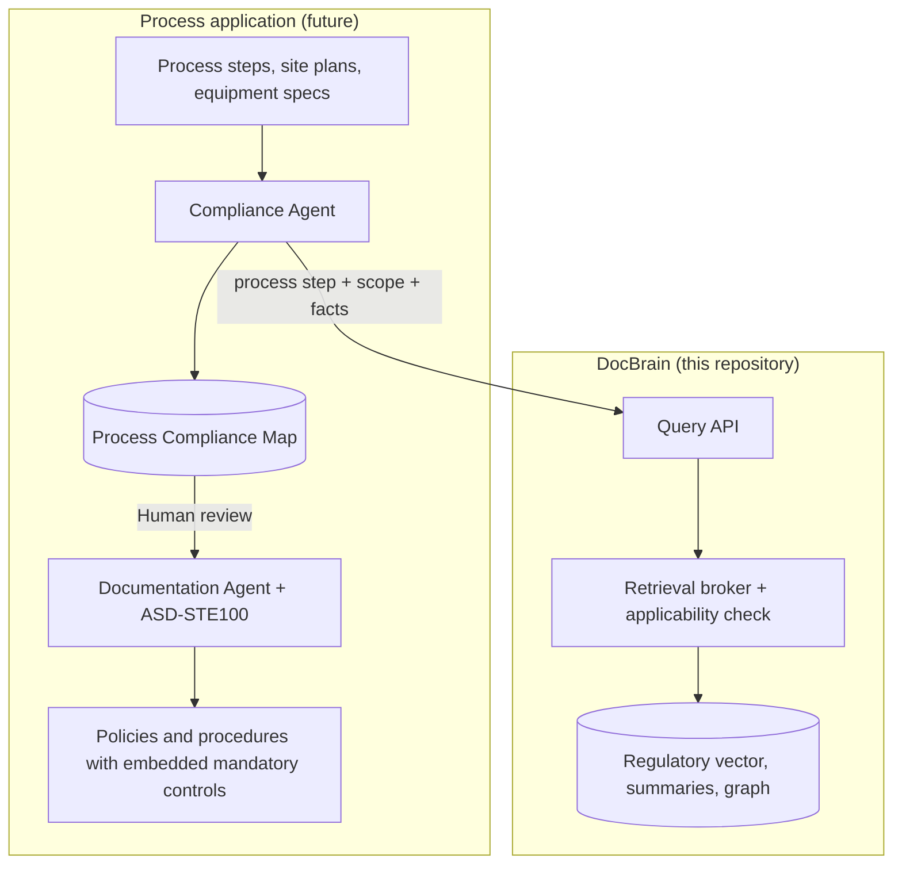

# Process application (future, separate from DocBrain)

Status: **not implemented in this repository**. Separated from DocBrain on 2026-10-26 after the idea whiteboard review. DocBrain is now the regulatory knowledge application. This folder keeps the process-application decisions, the plan and backlog sections, the doc sections, and the code that were moved out, so the separate application can start from them.

## Decisions carried over from the whiteboard

- **Separate applications (Option B).** The process application doesn't build its own knowledge graph and doesn't share DocBrain's stores. The Compliance Agent sends each process step, equipment item, and material to DocBrain's query API and gets back regulatory and standards requirements. DocBrain stores no site data.
- **Why not two merged graphs (Option A).**
  - The merge itself is fast, but every process document would first need LLM extraction and linking.
  - Drafting the documents dominates runtime either way.
  - Option B handles varied inputs (site plans, spec sheets) without a process ontology, keeps site data out of the shared stores, and reuses the broker.
  - Revisit Option A if retrieval misses too many site obligations, or when several sites need cross-site queries.
- **Inputs:** raw process steps, site plans, and equipment specifications.
- **Outputs:** policies and procedures with mandatory controls embedded, written in ASD-STE100. The ISO 9001, ISO 14001, and ISO 45001 requirements come from DocBrain, as adopted standards in its regulatory knowledge.
- **Agents:**
  - The **Compliance Agent** takes process steps and equipment specifications and queries DocBrain for obligations and controls.
  - The **Documentation Agent** writes the policies and procedures in the required format.
  - ASD-STE100 will be supplied as a raw document or as a skill.
- **Proposed conditions for the Compliance Agent:**
  1. Run two passes: a site pass (site facts matched against applicability conditions) and a step pass (one query per step, equipment item, and material).
  2. Persist a versioned Process Compliance Map. Each entry links a step, equipment item, or material to a requirement (ID and version) and its control, with a status of `applicable`, `not_applicable`, or `undetermined`, plus evidence and gaps. A human reviews the entries. The map stores requirement IDs, not copied text, so a requirement isn't duplicated across steps.
- **Sites:** one site for now, `GLOBAL.AU.VIC.AUWOD.3691` (Wodonga 3691). It inherits DocBrain regulatory scopes `GLOBAL`, `GLOBAL.AU`, `GLOBAL.AU.VIC`, and `GLOBAL.AU.VIC.AUWOD`. Applicability conditions are defined in DocBrain's regulatory pipeline. For example, export requirements (`GLOBAL.AU`) and manufacturing requirements (`GLOBAL.AU.VIC`) apply only if the product type is in each regulation's scope.
- **Publish layout:** to be decided in the process application.

## Proposed interface with DocBrain (not yet adopted)

The owner will set next steps after reviewing the separation. Until then, this is a proposal, not a DocBrain contract.

- **Request:** query text (a process step or a question), a scope code such as `GLOBAL.AU.VIC.AUWOD.3691`, optional facts (product types, activities, materials, quantities, adopted standards), and an optional as-of date.
- **Response:** for each requirement, its ID and version, source scope, cited source span, related controls, and applicability status with the condition tested and any missing facts. The response also includes the manifest revision it was answered from.
- **Change feed:** the requirements that changed between two manifest revisions, so the process application can mark affected documents `needs_review`.

## Contents

| Path | Moved from |
| --- | --- |
| [implementation_plan.md](./implementation_plan.md) | Process sections of `plans/implementation_plan.md` |
| [coding_tasks.md](./coding_tasks.md) | DB-031–DB-035, D01–D10, and related backlog sections of `plans/coding_tasks.md` |
| [docs.md](./docs.md) | Documentation Agent and site-documentation sections of `docs/` |
| `code/src/docbrain/documentation.py` | `src/docbrain/documentation.py` (template validation, leakage checks) |
| `code/src/docbrain/workflows/documentation.py` | `src/docbrain/workflows/documentation.py` (package lifecycle) |
| `code/src/docbrain/parsing_operational.py` | Operational-document section of `src/docbrain/parsing.py` |
| `code/src/docbrain/workflows/source_registration.py` | Mixed-source registration section of `src/docbrain/workflows/ingestion.py` |
| `code/src/docbrain/registry_packages.py` | Package tables and `Registry` package methods from `src/docbrain/registry.py` |
| `code/tests/unit/test_sources_and_templates.py` | `tests/unit/test_sources_and_templates.py` |
| `code/tests/unit/test_documentation_packages.py` | Package-lifecycle tests from `tests/unit/test_review_and_packages.py` |
| `code/tests/fixtures/documentation/` | `tests/fixtures/documentation/` (synthetic site packs, supplied-asset hashes, template requirements) |

The moved code is kept for reference. It is not importable or tested from this folder: the split files still rely on imports and helpers from the DocBrain modules they came from. The example process documents (the former `assets/publish`, including P-001, WI-007, the templates, and the OHS manual) were removed from the working tree. They remain in Git history at commit [`b2496fe`](https://github.com/dadpogu/docbrain/commit/b2496fe) under `assets/publish/`.

## Process hooks still in DocBrain

These shared models were left unchanged to keep the separation small. Prune them once the regulatory scope model is redesigned:

- `SiteScope` and `SiteScopeKind`, `ResourceScope.site` and `ResourceScope.process_id`, `RequestContext.site_ids`, and the site check in `is_authorized` (`src/docbrain/models.py`).
- The process values of `SourceRole`: `process_description`, `site_fact`, `organizational_policy`, `template`, and `generated_derivative`.
- `workflows/change_review.py` stays in DocBrain for regulatory change review. The moved package lifecycle depends on it.
